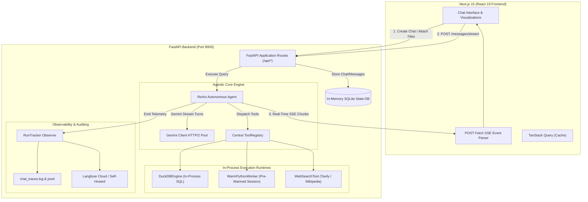

# 01. Architecture Overview

The DSAI Agentic Backend is an in-process, high-performance runtime built on FastAPI and Google GenAI SDK. It provides deterministic, ultra-low-latency data science reasoning, structured SQL analytics, and Python execution for the Next.js frontend.

---

## Architectural Topology

---

## Core Invariants & Design Principles

### 1. Ultra-Low Latency (< 5s Target)
Traditional multi-agent frameworks (LangGraph, CrewAI, AutoGen) introduce compounding latencies (15–45s) from inter-agent handoffs, complex graph traversals, and redundant LLM round-trips. DSAI uses a **single autonomous ReAct agent** with:
- Strict **2-turn budget** (Turn 1: Tool execution vs. Direct response; Turn 2: Synthesis).
- **In-process runtimes** (DuckDB and warm Python worker execute in < 20ms instead of spawning containerized cold sandboxes).
- **Persistent HTTP/2 SSL connection pooling** avoiding TCP/TLS handshake penalties.
- **Suppressed thinking budget** (`thinking_budget=0` on Flash-Lite models) for immediate token delivery.

### 2. Progressive Streaming Architecture
- The backend communicates strictly via **Server-Sent Events (SSE)** over `POST /api/chats/{id}/messages/stream`.
- Never waits for full completion before delivering tokens.
- Immediate Time to First Token (TTFT < 1.5s).
- Tool invocations, durations, and outputs stream progressively so the user sees tool execution chips render before assistant markdown text begins.

### 3. Clear Purpose-Driven File Classification
- Structured tabular data (`.csv`, `.parquet`, `.xlsx`) is classified as **Datasets** and automatically mounted into DuckDB (`dataset` table) and pandas (`df` dataframe).
- Generated visualizations, charts (`.png`), reports, and output documents are classified as **Artifacts**.

### 4. Client-Driven Cancellation & Session Safety
- If a user navigates away or refreshes the page, the frontend aborts the SSE stream.
- The backend checks `is_cancelled()` between generator iterations and halts further LLM calls, saving API tokens and preserving partial progress cleanly.
