# 02. ReAct Agent Loop

The `ReActAgent` ([backend/agent/react_loop.py](file:///d:/Github%20repositories/dsai-agent-frontend/backend/agent/react_loop.py)) implements an autonomous **Reasoning + Acting** loop bounded by a deterministic 2-turn budget.

---

## The 2-Turn Bounded Execution Lifecycle

```mermaid
sequenceDiagram
    autonumber
    actor User
    participant Router as FastAPI Router
    participant Agent as ReActAgent
    participant LLM as Google Gemini API
    participant Registry as ToolRegistry

    User->>Router: POST /api/chats/{id}/messages/stream
    Router->>Agent: stream_query(query, dataset_path)
    Agent-->>Router: SSE: agent.started & message.created
    
    rect rgb(30, 41, 59)
        Note over Agent,LLM: Turn 1: Execution & Evaluation
        Agent->>LLM: generate_content_stream(contents, tools=Registry.tools)
        alt Direct Answer (No Tools Required)
            LLM-->>Agent: Streaming Text Chunks
            Agent-->>Router: SSE: message.delta ("...")
            Agent-->>Router: SSE: run.completed (turns=1)
        else Tool Call Required
            LLM-->>Agent: FunctionCall(name, args)
            Agent-->>Router: SSE: tool.started(tool_call_id, name, args)
            Agent->>Registry: execute(name, args)
            Registry-->>Agent: Tool Result Dict
            Agent-->>Router: SSE: tool.completed(output, duration_ms)
        end
    end

    opt When Tool Executed (Turn 2: Synthesis)
        rect rgb(15, 23, 42)
            Note over Agent,LLM: Turn 2: Deterministic Synthesis (tools=None)
            Agent->>LLM: generate_content_stream(turn1_history, tools=None)
            LLM-->>Agent: Streaming Synthesis Text Chunks
            Agent-->>Router: SSE: message.delta ("Based on the data...")
            Agent-->>Router: SSE: run.completed (turns=2, metrics)
        end
    end

    Router-->>User: Final Rendered Assistant Message
```



---

## Detailed Turn Dynamics

### Turn 1: Tool Selection vs. Direct Streaming
When `client.aio.models.generate_content_stream` runs for Turn 1:
1. **Tool Declarations Active**: The agent presents Gemini with schemas for `run_duckdb_sql`, `run_python_code`, and `web_search`.
2. **Dynamic Dataset Introspection**: If a dataset is attached, its schema (`Columns: transaction_id (BIGINT), category (VARCHAR), revenue (DOUBLE)...`) is injected into the system prompt.
3. **Branching**:
   - **Case A: Direct Answer**: If the query is factual or general (e.g. *"What is L1 vs L2 regularization?"*), the model does not call any tools. It yields `message.delta` chunks immediately. The loop finishes at Turn 1 in under 3.5 seconds.
   - **Case B: Analytical Tool Call**: If the query requires SQL, Python, or Web Search, the model outputs a `FunctionCall`. The agent captures arguments, invokes the local runtime, and records execution metrics.

### Turn 2: Synthesis with Tool Suppression (`tools=None`)
To prevent infinite loops and runaway latency, **Turn 2 enforces a strict invariant**:
```python
if synthesis:
    turn_config = types.GenerateContentConfig(
        temperature=0.0,
        thinking_config=types.ThinkingConfig(thinking_budget=0),
        max_output_tokens=1024,
        tools=None,  # Crucial: Disable tool calling in Turn 2
        system_instruction=config.system_instruction,
    )
```
- By passing `tools=None`, Gemini is physically constrained from generating further tool calls.
- It transforms the raw tool output (JSON rows, stdout, or search snippets) into executive markdown summaries, formatted tables, and key insights.

---

## Prompt Engineering & Dataset Grounding

The prompt in [backend/agent/prompts.py](file:///d:/Github%20repositories/dsai-agent-frontend/backend/agent/prompts.py) directs the model to:
1. **Favor SQL for Tabular Queries**: Always prefer `run_duckdb_sql` on table `dataset` for filtering, grouping, aggregation, percentiles, and counts.
2. **Favor Python for Computation**: Use `run_python_code` for matrix math, scipy statistics, numpy operations, and multi-step algorithms.
3. **Be Direct and Executive**: Provide immediate answers supported by tables and bold values; do not invent reasoning traces or expose raw private instructions.

---

## Client Cancellation Guard

The ReAct loop monitors cancellation flags between every streaming chunk and tool execution:
```python
if is_cancelled and is_cancelled():
    return
```
When a user clicks **Stop** or closes the chat tab:
- Generation terminates immediately.
- Pending tool invocations are aborted.
- The partial assistant message is saved with status `interrupted` so progress is never lost.
