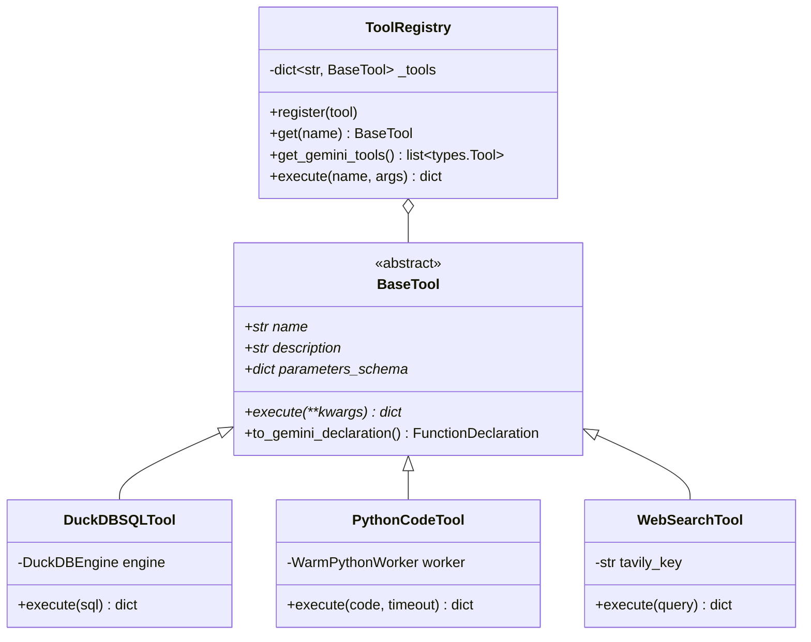

# 04. Tools & Registry Architecture

The tool layer ([backend/tools/](file:///d:/Github%20repositories/dsai-agent-frontend/backend/tools/)) provides a modular, extensible architecture decoupling tool implementations from the core `ReActAgent`.

---

## Tool Hierarchy & Design



---

## 1. `BaseTool` & Automatic Schema Generation

[backend/tools/base.py](file:///d:/Github%20repositories/dsai-agent-frontend/backend/tools/base.py) defines the contract for all tools. Subclasses define their name, description, parameters schema, and execute method:

```python
class BaseTool(ABC):
    @property
    @abstractmethod
    def name(self) -> str: ...

    @property
    @abstractmethod
    def description(self) -> str: ...

    @property
    @abstractmethod
    def parameters_schema(self) -> Dict[str, Any]: ...

    @abstractmethod
    def execute(self, **kwargs: Any) -> Dict[str, Any]: ...

    def to_gemini_declaration(self) -> types.FunctionDeclaration:
        """Automatically converts JSON schema to Google GenAI FunctionDeclaration."""
        ...
```

The `to_gemini_declaration()` helper translates standard JSON Schema types (`string`, `integer`, `number`, `boolean`, `array`, `object`) into Google GenAI SDK `types.Type` enums. Tool authors never need to write manual Gemini protobuf mappings.

---

## 2. Implemented Tools

### `DuckDBSQLTool` (`run_duckdb_sql`)
- **File**: [backend/tools/duckdb_tool.py](file:///d:/Github%20repositories/dsai-agent-frontend/backend/tools/duckdb_tool.py)
- **Parameters**: `sql` (string)
- **Execution**: Runs query against `DuckDBEngine`, returning `columns`, `rows`, `row_count`, and `execution_time_ms`.

### `PythonCodeTool` (`run_python_code`)
- **File**: [backend/tools/python_tool.py](file:///d:/Github%20repositories/dsai-agent-frontend/backend/tools/python_tool.py)
- **Parameters**: `code` (string), optional `timeout` (number)
- **Execution**: Executes code snippet inside `WarmPythonWorker`, returning `stdout`, `stderr`, `error`, and `execution_time_ms`.

### `WebSearchTool` (`web_search`)
- **File**: [backend/tools/search_tool.py](file:///d:/Github%20repositories/dsai-agent-frontend/backend/tools/search_tool.py)
- **Parameters**: `query` (string)
- **Execution**: Queries the Tavily Search API if `TAVILY_API_KEY` is present; otherwise falls back automatically to Wikipedia OpenSearch and page summary APIs. Zero hard failure if external keys are missing.

---

## 3. How to Add a New Tool in 3 Steps

The registry architecture makes expanding capabilities seamless without modifying `ReActAgent` or `react_loop.py`.

### Step 1: Create Tool Class
Create `backend/tools/my_tool.py`:
```python
from backend.tools.base import BaseTool

class SentimentAnalysisTool(BaseTool):
    @property
    def name(self) -> str:
        return "analyze_sentiment"

    @property
    def description(self) -> str:
        return "Analyze text sentiment, returning polarity and subjectivity scores."

    @property
    def parameters_schema(self) -> dict:
        return {
            "type": "object",
            "properties": {
                "text": {"type": "string", "description": "The text to evaluate"}
            },
            "required": ["text"],
        }

    def execute(self, text: str = "", **kwargs) -> dict:
        # Perform computation
        return {"sentiment": "positive", "score": 0.88, "execution_time_ms": 2.1}
```

### Step 2: Register in `ToolRegistry`
In [backend/tools/registry.py](file:///d:/Github%20repositories/dsai-agent-frontend/backend/tools/registry.py):
```python
from backend.tools.my_tool import SentimentAnalysisTool

def create_default_registry(...) -> ToolRegistry:
    registry = ToolRegistry()
    ...
    registry.register(SentimentAnalysisTool())
    return registry
```

### Step 3: Verify with Pytest
Run the tool registry test suite:
```powershell
.\.venv\Scripts\python.exe -m pytest -v backend/tests/test_tools_expansion.py
```
Gemini will automatically receive the new function declaration in Turn 1 and can invoke it immediately.
