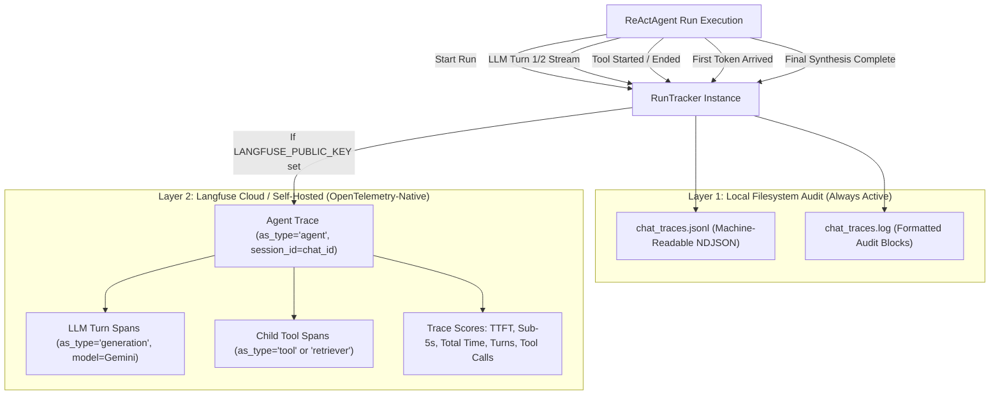

# 06. Observability & Langfuse Tracing

[backend/observability.py](file:///d:/Github%20repositories/dsai-agent-frontend/backend/observability.py) provides a dual-layer telemetry and tracing architecture designed to give full visibility into every agent run, tool execution, LLM reasoning turn, and latency breakdown.

---

## Observability Architecture



---

## 1. Local Filesystem Audit Trail

Every chat execution writes to `backend/logs/` in real time, protected by a thread lock `_log_lock`:

### Machine-Readable: `chat_traces.jsonl`
Each line contains a complete JSON record of the run:
```json
{
  "run_id": "run-767b81e8-3278-4081-9e8d-be562ef72015",
  "chat_id": "chat-0c03aa07-d97e-4c0f-a0dd-902619ba506e",
  "timestamp": "2026-11-21T11:45:27.431991+00:00",
  "finished_at": "2026-11-21T11:45:32.729860+00:00",
  "status": "completed",
  "model": "gemini-3.1-flash-lite",
  "metrics": {
    "total_response_time_ms": 3669,
    "ttft_ms": 3639,
    "tool_execution_time_ms": 19,
    "llm_time_ms": 3650,
    "turn_count": 2,
    "tool_calls_count": 1
  },
  "tools": [
    {
      "name": "run_duckdb_sql",
      "duration_ms": 19,
      "arguments": { "sql": "SELECT category, SUM(revenue) FROM dataset GROUP BY category" }
    }
  ]
}
```

### Human-Readable: `chat_traces.log`
Formatted text blocks allow engineers to inspect prompt queries, tool durations, and responses without opening an external dashboard:
```text
================================================================================
[2026-11-21T12:00:56.911292+00:00] RUN: bench-q4-1795262456 | CHAT: bench-session
MODEL: gemini-3.1-flash-lite | STATUS: COMPLETED
TOTAL RESPONSE TIME: 3,914 ms | TTFT: 3,872 ms | TOOLS: 8 ms (1 calls) | LLM: 3,906 ms
--------------------------------------------------------------------------------
[USER QUERY]:
Given sample A and sample B, calculate independent two-sample t-statistic.

[TOOL CALL 1]: run_python_code (Duration: 8 ms)
  Arguments:
{ "code": "from scipy import stats..." }
  Stdout:
    T-statistic: 4.639 | P-value: 0.00057

[ASSISTANT RESPONSE]:
The independent two-sample t-test results indicate a statistically significant difference...
================================================================================
```

---

## 2. Langfuse Tracing & Scoring Integration

Installed and aligned with the official Langfuse AI skill (`github.com/langfuse/skills`), following standard OpenTelemetry-native conventions:

### Configuration
Set the following keys in `backend/.env`:
```env
LANGFUSE_PUBLIC_KEY=pk-lf-...
LANGFUSE_SECRET_KEY=sk-lf-...
LANGFUSE_HOST=https://cloud.langfuse.com   # (or LANGFUSE_BASE_URL, e.g. https://cloud.langfuse.com or https://us.cloud.langfuse.com)
```

### Trace Hierarchy & Observation Types
1. **Agent Trace**: Root observation (`as_type="agent"`, name `"dsai_agent_run"`).
   - Attribute propagation via `propagate_attributes`:
     - `session_id=chat_id`: Groups multi-turn runs into conversational threads in the Langfuse Sessions view.
     - `user_id`: Identifies the user for analytics and cost allocation.
     - `tags`: Filterable tags `["dsai-agent", "phase-0", model]`.
     - `input`: `{"query": user_query}`
     - `output`: Final synthesized response.
2. **Generation Spans**: Each Gemini reasoning/synthesis turn creates an observation (`as_type="generation"`, name `"gemini_turn_1"` / `"gemini_turn_2"`), recording the model, input messages/prompt, and generated output tokens.
3. **Child Tool & Retriever Spans**:
   - Database and Python code execution: `as_type="tool"`.
   - Web Search: `as_type="retriever"`.
   - Records input arguments, execution duration, and structured outputs.
4. **Automated Telemetry Scoring**: When the run finishes, `RunTracker` publishes 5 standardized scores:
   - `total_response_time_ms` (Gauge: Total run time)
   - `ttft_ms` (Gauge: Time to First Token)
   - `sub_5s` (Boolean Metric: 1.0 if total < 5000ms, else 0.0)
   - `turns` (Integer: Number of ReAct turns)
   - `tool_calls_count` (Integer: Total tool invocations)

### Non-Blocking Fallback
If Langfuse credentials are not provided:
- `get_langfuse()` returns `None`.
- `RunTracker` operates entirely locally with zero overhead, zero network delays, and no exceptions.

---

## 3. Health Endpoint Telemetry
The `/health` endpoint exposes real-time configuration status:
```json
{
  "status": "healthy",
  "engine": "duckdb-in-process",
  "gemini_configured": true,
  "gemini_model": "gemini-3.1-flash-lite",
  "langfuse_configured": true,
  "timestamp": "2026-11-22T08:20:00+00:00"
}
```
