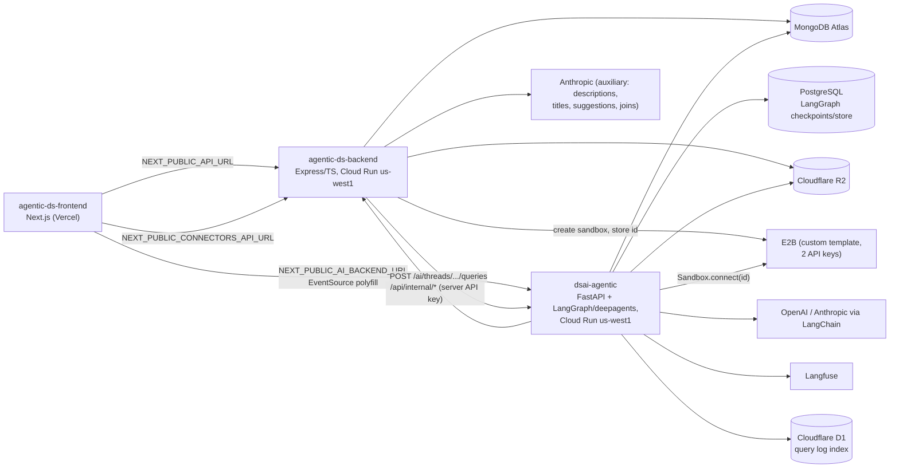
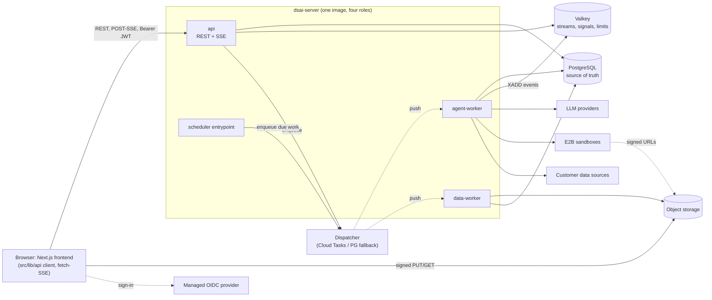
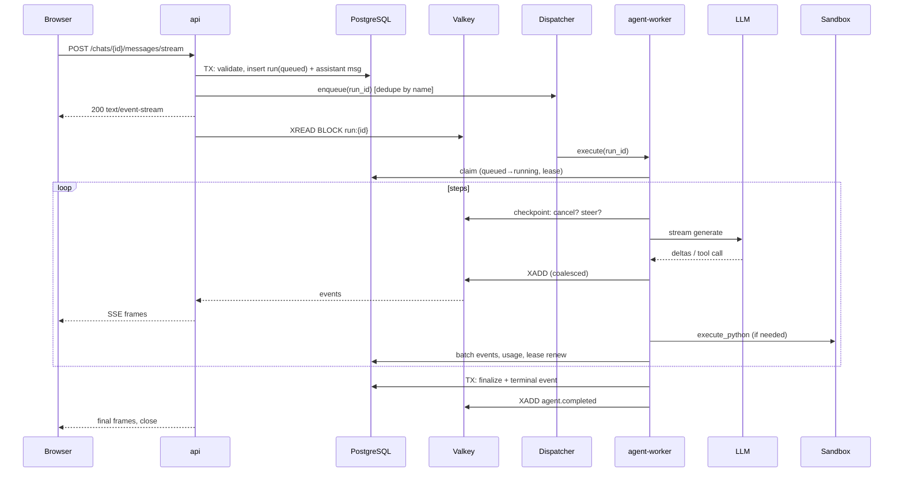
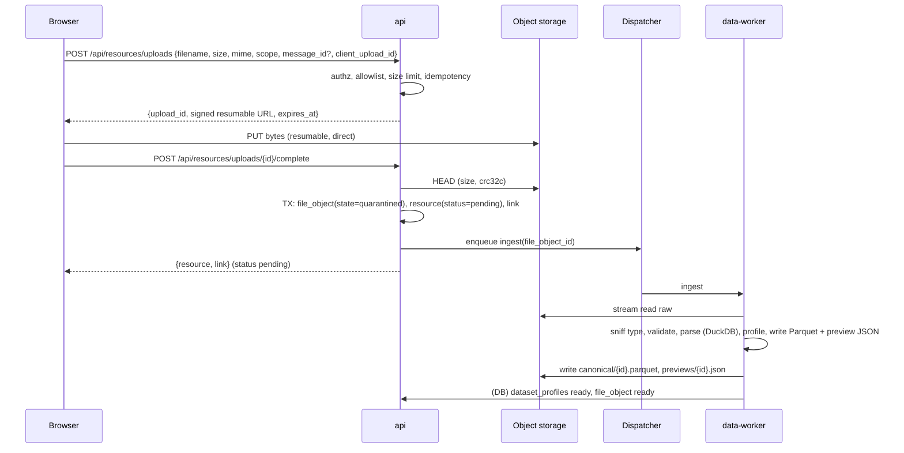

# DSAI Backend Architecture Proposal

| | |
|---|---|
| **Status** | Proposed — for technical review. Not approved. Nothing in this document has been implemented. |
| **Date** | 2026-11-28 |
| **Scope** | Backend for the redesigned DSAI MVP (`althafsheez/dsai-agent-frontend`) and its growth path |
| **Companion documents** | [ARCHITECTURE_DECISIONS.md](ARCHITECTURE_DECISIONS.md) · [BACKEND_IMPLEMENTATION_ROADMAP.md](BACKEND_IMPLEMENTATION_ROADMAP.md) · [diagrams/](diagrams/) |
| **Evidence base** | Source inspection of four repositories (listed in §3.1), current vendor documentation and pricing pages read on 2026-11-28 (listed in §23). |

### How to read this document

- **Verified** statements cite a file and line in an inspected repository, or an external source in §23 (`[R#]`).
- **Proposed** statements are design decisions that require team approval. They are labelled *Proposed* or appear in ADRs.
- **Assumptions** are labelled *Assumption*. Every capacity and cost figure is a planning estimate derived from list prices and stated assumptions. **No figure in this document is a measured benchmark.**
- Open questions are collected in §21.

---

## Table of contents

1. [Executive summary](#1-executive-summary)
2. [Product context and requirements](#2-product-context-and-requirements)
3. [Analysis of the previous Monks.tech backend and the current prototype](#3-analysis-of-the-previous-monkstech-backend-and-the-current-prototype)
4. [Architecture alternatives](#4-architecture-alternatives)
5. [Technology comparison](#5-technology-comparison)
6. [Recommended architecture](#6-recommended-architecture)
7. [System architecture diagrams](#7-system-architecture-diagrams)
8. [Backend module decomposition](#8-backend-module-decomposition)
9. [API and request lifecycle](#9-api-and-request-lifecycle)
10. [Streaming design](#10-streaming-design)
11. [Database design](#11-database-design)
12. [AI and agent execution design](#12-ai-and-agent-execution-design)
13. [Dataset and file processing](#13-dataset-and-file-processing)
14. [Security](#14-security)
15. [Deployment and infrastructure](#15-deployment-and-infrastructure)
16. [Performance and scalability](#16-performance-and-scalability)
17. [Capacity planning](#17-capacity-planning)
18. [Cost analysis](#18-cost-analysis)
19. [Risks and trade-offs](#19-risks-and-trade-offs)
20. [Architecture Decision Records (summary)](#20-architecture-decision-records-summary)
21. [Open questions](#21-open-questions)
22. [Migration and implementation roadmap (summary)](#22-migration-and-implementation-roadmap-summary)
23. [Final recommendation](#23-final-recommendation)
24. [References](#24-references)

---

## 1. Executive summary

**Recommendation (Proposed):** build DSAI's backend as a **Python modular monolith with independently scalable worker roles**, on **PostgreSQL** as the system of record, **object storage** for bytes, a small **Valkey** instance for ephemeral coordination (live event fan-out, cancel/steer signals, rate limits), **SSE** for streaming, and **E2B** for sandboxed code. Deploy on **Google Cloud Run** in one region. One repository and one container image run as four process roles:

| Role | What it does | Why it is separate |
|---|---|---|
| `api` | REST + SSE, authentication, authorization, run acceptance, signed URLs | Latency-sensitive, many idle streaming connections, must never be blocked by agent or data work |
| `agent-worker` | Agent loop, model gateway, tools, sandbox lifecycle, event emission | Long-lived (seconds to minutes), I/O-bound, scales with active runs |
| `data-worker` | Upload validation, profiling, Parquet conversion, previews, derived datasets, dashboard queries | CPU- and memory-heavy, must not share a process with API or agent loops |
| `scheduler` (entrypoint, not a service) | Workflow schedules, retention, stale-run reconciliation | Must run exactly once per tick regardless of replica count |

**Why this and not microservices:** DSAI has one product team, one domain model (chats, runs, resources) with strong transactional coupling, and its scaling pressure is concentrated in two workloads (agent runs and data processing). The previous DSAI system split responsibilities across a Node.js API and a Python agent service and paid for it in cross-service protocols: the Node API reserves threads with MongoDB leases, renews them on a heartbeat, polls for cancellation, and keeps "uncertain outcome" recovery records because the Python service creates queries the Node service must later reconcile (`agentic-ds-backend/src/controllers/querySubmissionController.ts:150-215, 470-500`). A modular monolith keeps those operations in one transaction while still letting the two heavy workloads scale on their own.

**Why not keep the current prototype as is:** the backend already in this repository (`server/backend`, `server/agentic`) is a deliberately minimal, single-process design (FastAPI + SQLite + in-process run coordinator, `PROJECT_SPEC.md` "minimal, functional, replaceable backend"). It proves the product flows, and its contracts are worth keeping, but it cannot run on more than one process: run state and cancellation live in a Python dict (`server/backend/app/services/runs.py:26-63`), SQLite allows one writer at a time [R1], schedulers run inside every API process (`server/backend/app/main.py:69-70`), and synchronous database calls run on the event loop for every streamed token (`server/backend/app/services/runs.py:536-558`).

**What changes for the frontend:** almost nothing. The proposal keeps `API_CONTRACT.md` — routes, DTOs, the SSE envelope `{event_id, run_id, type, data, timestamp, sequence}` and idempotency rules. Required frontend changes are confined to `src/lib/api/client.ts`: replace the `X-Demo-User-Id` header with a bearer token, and (in Phase 2) add a signed-URL upload path behind the existing upload function. See §22.

**Where the money goes:** at every planning scenario the estimated model provider bill exceeds the infrastructure bill by more than an order of magnitude under the stated token assumptions (§18). Token efficiency (context compaction, schema summaries instead of raw rows, caching) is therefore a first-class architectural concern, not an optimisation for later.

**Top risks:** LLM provider rate limits are per project and are the first hard ceiling on concurrent runs [R12]; sandbox concurrency is plan-limited [R14]; event write volume can overwhelm PostgreSQL if token deltas are persisted one row per chunk (the current prototype does this). Each has a specific mitigation in §16 and §19.

---

## 2. Product context and requirements

### 2.1 What the MVP is (verified from this repository)

Sources: `PROJECT_SPEC.md`, `API_CONTRACT.md`, `IMPLEMENTATION_PLAN.md`, `README.md`, `src/features/*`, `src/lib/api/client.ts`.

| Area | Frontend surface | Backend status in this repo |
|---|---|---|
| Identity | `/login` demo user selector, `useAuth()` | Demo header `X-Demo-User-Id`, two predefined users (`server/backend/app/services/identity.py:10-13`). Explicitly not production security. |
| Workspaces | `/workspaces`, `/workspaces/[id]` (chats, datasets, context files, invites) | Implemented; access is owner-only (`server/backend/app/services/records.py:26,90`) |
| Chats | `/chat/[chatId]`, one route for standalone and workspace chats; move preserves ID | Implemented |
| Runs | POST-SSE stream, queue, reorder, edit queued, steer, cancel, retry | Implemented, single process |
| Resources | Upload-on-Send, datasets vs artifacts, previews, downloads, Library | Implemented on local disk, 25 MB in-memory upload cap (`server/backend/app/services/resource_uploads.py:38`) |
| Quick Assistant | Separate read-only conversation threads | Implemented |
| Connectors | PostgreSQL (loopback/dev only), Google Drive OAuth import/sync | Implemented with restrictions (`server/backend/README.md`) |
| Dashboards | Grid editor, SQL, DAX-style measures, AI generation, sharing, Drive sync | Implemented as a prototype (`server/backend/app/routes/dashboards.py`, `services/dax.py`) |
| Workflows | Store, AI planning, schedules, runs | Implemented as a prototype with an in-process scheduler (`server/backend/app/services/workflow_engine.py`) |
| Usage | Sidebar usage stats | Frontend feature only; no usage metering found in `server/` (no token accounting found by search for `usage_metadata`/token fields) |

### 2.2 Product invariants the backend must preserve

From `AGENTS.md` and `API_CONTRACT.md`. These are hard requirements, not preferences:

1. First Send creates the chat; files stay in browser memory until Send; create chat → upload/register → start run.
2. Structured files (CSV/Excel/Parquet) are Datasets; images/charts/PDFs/reports are Artifacts — for uploads and generated outputs alike.
3. Bytes are stored once with stable IDs; links define scope; favourites are references.
4. Messages, public execution details and outputs persist progressively; no fabricated reasoning; no secrets in traces.
5. One active main run per chat; Queue persists and runs after completion; Steer applies at safe checkpoints.
6. Leaving the chat or refreshing cancels the run and preserves progress (current product policy — see §10.6 and open question Q1).
7. Retry creates a new run against the original user message, never duplicating it.
8. Quick Assistant is read-only and independent of the main run.
9. Sandbox outputs only from `/home/user/outputs/`, with path, ownership, type, size and dedup validation.

### 2.3 Workload characteristics (derived)

These drive the architecture more than any feature list:

| Workload | Shape | Bottleneck resource |
|---|---|---|
| CRUD (chats, history, library, workspaces) | Many short requests, read-heavy, paginated | DB round trips, connection count |
| Agent run | One request starts 10 s – 15 min of work; 1–8+ model calls; 0–N sandbox executions; hundreds of small events | Provider latency and rate limits; event write amplification; sandbox concurrency |
| Live stream | One long-lived HTTP response per active viewer; mostly idle | Open connections per API instance; fan-out latency |
| Upload/ingest | Large bodies (target ≥ 1 GB), parse/profile/convert | Network, memory, CPU |
| Preview | Must be fast regardless of file size | Pre-computation, not query speed |
| Dashboards | Aggregations over whole datasets | Columnar scan speed (CPU) |
| Scheduled workflows | Time-triggered runs | Exactly-once triggering |

### 2.4 MVP vs future requirements

| Capability | MVP (next release) | Future |
|---|---|---|
| Real authentication (OIDC), workspace RBAC | Yes | SSO/SAML, SCIM |
| Workspaces and membership roles | Yes (owner/manager/contributor/viewer, as in the previous system) | Organisations above workspaces, billing accounts |
| Chat runs, queue, steer, retry, cancel | Yes | Background runs that survive page close (product decision Q1) |
| Datasets: CSV/Excel/Parquet up to a defined limit (proposed 1 GB) | Yes | Multi-GB, incremental refresh, lakehouse connectors |
| Sandbox execution (E2B) | Yes | Self-hosted sandbox fleet if cost/latency requires |
| Multi-model | Gemini allowlist + gateway abstraction | Additional providers, BYOK (previous system had it) |
| Connectors | PostgreSQL, Google Drive | BigQuery, Snowflake, Databricks (previous system had these) |
| Dashboards and workflows | Persist and execute correctly at small scale | Large-scale scheduling, alerting, sharing outside workspace |
| Usage tracking | Metering ledger (tokens, sandbox seconds, storage) | Billing, quotas per plan, invoicing |
| Audit log | Security-relevant actions | Export, retention policies per customer |
| Real-time collaboration | No | Presence, co-editing |

---

## 3. Analysis of the previous Monks.tech backend and the current prototype

### 3.1 What was inspected

All four repositories under `D:\Projects\Monks.tech` were accessible. Nothing was inaccessible. The `wt/` folder contains ticket worktrees of the same repositories and `evidence/` contains test evidence; they were not analysed separately.

| Repository (remote) | Local branch inspected | Relation to integration branch | Role |
|---|---|---|---|
| `agentic-ds-backend` (`rohanrony/agentic-ds-backend`) | `dev/v0.5/anita/DSAI-820-821-…` | 1 commit ahead of `origin/dev-test/v0.5` (`bef6320`, 2026-10-23) | Previous **Node.js/TypeScript API** |
| `dsai-agentic` (`rohanrony/dsai-agentic`) | `feat/anita-dsai-912/…` | 1 ahead, 9 behind `origin/dev-test/v0.5` (`bab7c01`, 2026-10-04) | Previous **Python agent service** |
| `agentic-ds-frontend` (`rohanrony/dsai-frontend`) | `dev/v0.5/anita/DSAI-936-…` | 1 ahead, 2 behind `origin/dev-test/v0.5` | Previous **Next.js frontend** |
| `dsai-agent-frontend` (`althafsheez/dsai-agent-frontend`) | `origin/main` @ `84dc77d` (2026-11-25) | — | **New MVP**: frontend plus prototype backend in `server/` |

Limitation: the previous repositories were inspected as checked out locally (close to their integration branches); production configuration (Cloud Run service settings, Atlas cluster size, secrets) was not available, so statements about production behaviour are limited to what source and deploy files show.

### 3.2 Previous architecture (verified)



| Concern | Previous implementation | Evidence |
|---|---|---|
| API framework | Express 4 + TypeScript; 28 route files, 19 controllers | `agentic-ds-backend/package.json`, `src/routes/` |
| Agent service | FastAPI 0.115, single `uvicorn` process per container | `dsai-agentic/main.py`, `Docker/dockerfile` (CMD) |
| Agent framework | LangGraph 1.1 + `deepagents` 0.5: supervisor with sub-agents (dataframe ops, SQL, stats, plotter), summariser and token-awareness middleware | `dsai-agentic/src/Agent_tools/Graph.py:4-13, 420-500`; `configs/*.yaml` |
| Models | OpenAI and Anthropic through LangChain; per-agent model config; context ceilings per model | `Graph.py:53-108`; `configs/model.yaml` |
| Primary database | MongoDB Atlas (both services) | `agentic-ds-backend/src/models/database.ts`; `dsai-agentic/requirements.txt` (`motor`) |
| Agent state | LangGraph `AsyncPostgresSaver`/`AsyncPostgresStore`, cached per schema; in-memory fallback | `Graph.py:116-276` |
| Object storage | Cloudflare R2 (S3 API), presigned PUT for large files up to 100 MB | `agentic-ds-backend/src/config/index.ts:298-310`; `Backend Architecture Documentation.md` §File Processing |
| File processing | Parquet conversion, streaming from R2, Polars/DuckDB/ExcelJS; 3,146-line table extraction service | `src/services/tableExtractionService.ts`, docs §RAM Optimization |
| Sandbox | E2B custom template, created by Node, connected by ID from Python; timeout by plan; two rotating API keys | `src/services/sandboxService.ts:267-377, 1293-1306`; `dsai-agentic/src/Agent_tools/sandbox_tools.py:56-108` |
| Streaming | SSE; per-query bounded `asyncio.Queue` subscribers plus MongoDB catch-up polling and `Last-Event-ID` replay; named `ping` heartbeat | `dsai-agentic/src/APIs/sse_manager.py:21-330` |
| Execution | Agent runs as an `asyncio` background task in the API process; cancellation via task registry | `dsai-agentic/src/APIs/queries_api.py:33-49, 272-290, 471-567` |
| Auth | Self-built JWT (30 min access + refresh), bcrypt, temporary users | `src/services/authService.ts`, `src/config/index.ts:224-228`, `src/middleware/tempUser.ts` |
| Authorization | Space roles owner/manager/contributor/viewer stored as a map `access.<userId>` inside each space document | `src/models/spaceModel.ts:91-106, 212, 386-394` |
| Rate limiting | `express-rate-limit` with no shared store configured | `src/middleware/rateLimiter.ts:8-30` |
| Usage/billing | Cost log and credit ledger collections with unique `(eventId, queryId)` index | `src/models/costLogModel.ts:33-45`, `creditLedgerModel.ts` |
| Observability | Request telemetry/tracing middleware, hand-rolled in-process metrics registry; Langfuse; Google Cloud Error Reporting; Sentry (frontend) | `src/services/observability/metricsRegistry.ts`, `dsai-agentic/requirements.txt` |
| Deployment | Cloud Build → Cloud Run `us-west1`, Node heap capped at 800 MB; Python service deployed `--allow-unauthenticated` | `agentic-ds-backend/cloudbuild.yaml`, `Dockerfile`; `dsai-agentic/cloudbuild.yaml` |
| Connectors | BigQuery, Snowflake, Databricks, Supabase, Google Drive, OneDrive, Google Ads | `src/routes/*.ts`, `src/services/connectors/` |

### 3.3 What worked well (retain)

1. **Durable event log with ordered, replayable SSE.** The Python SSE manager persists events, replays after `Last-Event-ID`, keeps subscriber queues bounded, and re-reads persistence to recover events produced on another instance (`sse_manager.py:241-330`). This is the right model; the new design keeps it and replaces polling with a stream broker.
2. **Direct-to-object-storage uploads and Parquet as the working format** (docs §Realtime File Upload). It avoided Cloud Run's 32 MiB HTTP/1 body limit [R7] and kept memory bounded.
3. **Client-generated request IDs for idempotent sends** (`querySubmissionController.ts:133-142`). The new contract keeps `client_request_id` everywhere.
4. **Workspace roles** owner/manager/contributor/viewer — a sensible role set the new schema adopts (relationally).
5. **Cost logs/credit ledger with idempotent unique keys** — the right shape for usage metering.
6. **Custom E2B template** with pre-installed packages — reduces per-run package installation.
7. **Diagnostics discipline**: terminal-outcome manager and public error categories (carried forward in the new prototype's `agentic/runtime/diagnostics.py`).

### 3.4 Weaknesses (with evidence)

| # | Weakness | Evidence | Consequence |
|---|---|---|---|
| P1 | **Two backends sharing one domain.** Node owns threads, files, sandboxes; Python owns queries and agent execution; each calls the other (`/api/internal/*`, `/ai/threads/.../queries`). The architecture doc says the dual backend "has been collapsed into a single service", but the code still deploys two services that call each other. | `Backend Architecture Documentation.md` §System Overview vs `querySubmissionController.ts:350-372`, `config/index.ts:90-94` | Distributed-transaction workarounds (P2), duplicated auth, two deploy pipelines, cross-service sandbox ownership |
| P2 | **Cross-service submission protocol.** Thread reservation with a MongoDB lease, heartbeat renewal at TTL/3, cancellation polling, "outcome uncertain" recovery records, and in-process join of duplicate submissions. | `querySubmissionController.ts:150-215, 470-500` | Hard to reason about, hard to test, and the in-memory join map only deduplicates within one instance |
| P3 | **Execution coupled to API instance.** Agent runs are `asyncio` tasks inside the API container; cancellation uses an in-process task registry. | `queries_api.py:33-49, 434` | Instance shutdown or scale-in kills runs; cancellation must reach the same instance; with Cloud Run request-based billing, CPU is only allocated during requests [R8] |
| P4 | **Multi-agent supervisor complexity.** Supervisor + four sub-agents + summariser + token-awareness + dataset-context middleware, each with its own model configuration. | `Graph.py:420-577`, `configs/` (8 YAML files) | More model calls per question (latency and cost), harder failure attribution. The new MVP deliberately moved to one agent (`PROJECT_SPEC.md`) |
| P5 | **Three data stores for one product** (MongoDB, PostgreSQL for agent checkpoints, Cloudflare D1 for a query log index) plus R2. | `requirements.txt`, `Graph.py:188-262`, `src/services/d1_index_service.py` | No cross-store transactions; operational surface for a small team |
| P6 | **Authorization data not indexable as designed.** Roles stored as dynamic keys `access.<userId>`; "shared with me" queries filter `{"access.<userId>": {$exists: true}}`. | `spaceModel.ts:91-106` | Ordinary indexes cannot serve dynamic field names; such queries tend toward collection scans as data grows (a wildcard index would be required) |
| P7 | **Per-instance rate limiting and metrics.** No shared store for the rate limiter; metrics registry held in process memory. | `rateLimiter.ts:8-30`, `metricsRegistry.ts:72` | Limits multiply with instance count; metrics fragment per instance |
| P8 | **Agent service publicly invocable** (`--allow-unauthenticated`), relying on in-app JWT middleware; wide CORS regex including `*.onrender.com`. | `dsai-agentic/cloudbuild.yaml`, `main.py` CORS config | Larger attack surface than an internal-only worker |
| P9 | **Memory-constrained containers** — Node heap capped at 800 MB to fit Cloud Run defaults; large-file processing in the API container. | `Dockerfile` CMD, docs §RAM Optimization | File processing competes with request handling |

### 3.5 Current prototype backend in this repository (verified)

The new repository is **not frontend-only**: `server/backend` (FastAPI, 97 tracked files, 20 Alembic revisions) and `server/agentic` (agent runtime, 30 files) implement most of `API_CONTRACT.md`. The spec defines it as "minimal, functional, replaceable", with "no Redis, Celery, Kafka, multi-agent framework, microservices or workflow engine" (`PROJECT_SPEC.md`). Its deployment target appears to be Railway (`server/requirements.txt`, commit `84dc77d`); no deploy configuration other than the requirements file is tracked.

**Strengths to keep:**

- Clean contracts: `LLMProvider`, `AgentExecution`, `ToolHost`, `ToolContext` (`server/agentic/runtime/contracts.py`) separate provider, runner, tools and application. These map directly onto the proposed model gateway and tool layer.
- Execution is already decoupled from the HTTP connection: the route starts `execute_run_in_background` and the response tails persisted events (`server/backend/app/routes/runs.py:43-58`; `services/runs.py:680-732`).
- Correct idempotency and ordering constraints: `uq_run_request`, `uq_message_chat_position`, `uq_event_run_sequence` (`server/backend/app/models.py`).
- Startup reconciliation of stale runs (`services/runs.py:735-745`).
- Storage abstraction that never accepts caller paths and rejects symlinks and escapes (`server/backend/app/storage/local.py`).
- E2B pool that bounds timeouts, scans only `/home/user/outputs`, and closes sandboxes per run (`server/agentic/execution/e2b.py:55-300`).
- Gemini provider with retry options and model fallback among allowlisted models with the same effort (`server/agentic/providers/gemini.py:39-41, 196-205`).
- Hardened connector code: SQL parsing with `pglast`, read-only transactions, statement timeout, IP pinning, SSRF guards (`server/backend/app/connectors/`).

**Limits that block horizontal scaling or production use:**

| # | Issue | Evidence | Impact |
|---|---|---|---|
| C1 | SQLite as the only database | `server/backend/app/config.py:24`, `db.py` | One writer at a time; WAL needs all processes on one host [R1][R2] — rules out multiple instances |
| C2 | Run state, cancellation, viewers and tasks in a Python dict | `services/runs.py:26-63` | Cancel/steer must hit the same process; restarts lose control state |
| C3 | Synchronous ORM calls inside `async def` dependencies and generators | `dependencies.py:11-13`; `services/runs.py:536-558` | Blocks the event loop; FastAPI only offloads plain `def` endpoints to a threadpool [R5] |
| C4 | Per-delta write amplification: each `message.delta` opens a session, rewrites the whole assistant content, runs `SELECT max(sequence)+1`, inserts, commits and refreshes | `services/runs.py:310-316, 536-558` | O(n²) bytes rewritten per answer; several round trips and a commit per token chunk |
| C5 | SSE delivery by polling the database every 100 ms per open stream | `services/runs.py:706-732` | Read load grows linearly with viewers; 100 ms added latency floor |
| C6 | Schedulers inside the API process (`dashboard_sync.sync_loop`, `workflow_engine.scheduler_loop` at 1 s), selecting due rows without a claim; schedules computed in server local time | `main.py:69-70`; `workflow_engine.py:153-154, 565-584` | With more than one replica, every replica fires the same workflow |
| C7 | Uploads read fully into memory, capped at 25 MB, stored on local disk | `services/resource_uploads.py:38`; `storage/local.py` | Local disk is not shared across instances or durable on Cloud Run/Railway |
| C8 | Dashboard SQL loads rows into a throw-away in-memory SQLite per request, from at most the first 6,000 rows | `services/dashboard_sql.py:3, 79-104`; `services/dataset_preview.py:66` | Aggregates over larger datasets reflect only a prefix (I did not verify whether the UI discloses this); CPU work in the API process |
| C9 | Model-written dashboard scripts run in a local `python -I` subprocess with AST filtering and resource limits | `services/dashboard_script.py:1-30, 88-92` | Reasonable as a safety net, but it is code execution on the API host; production should use the sandbox |
| C10 | Demo identity only; owner-only access checks; invitations stored but no membership-based access | `services/identity.py`; `services/records.py:26,90` | Collaboration features cannot be authorised |
| C11 | No usage metering or rate limiting | search of `server/` for token usage fields and limiters | Cost cannot be attributed or bounded |
| C12 | Full workspace/tool context JSON embedded in the system instruction of each model call | `providers/gemini.py:165-189` | Token cost grows with inventory size on every turn |

### 3.6 Lessons that shape the new architecture

1. **Keep the domain in one deployable.** Cross-service ownership of a single concept (a query/run) was the main source of complexity in the previous system (P1, P2). Split by *workload* (API vs worker vs data), not by *entity*.
2. **Never tie execution to the process that holds the HTTP connection.** Both the previous service (P3) and the prototype (C2) did. Run state must be in the database; control signals in a shared store.
3. **One transactional store.** MongoDB + PostgreSQL + D1 (P5) and SQLite (C1) both failed this test in different ways. PostgreSQL covers relational data, JSONB documents, queue-like tables and agent checkpoints.
4. **Model authorization relationally** (P6): `workspace_members(workspace_id, user_id, role)` is indexable and enforceable by row-level security.
5. **Treat events as a log, not as rows written per token** (C4, C5). Coalesce, buffer, and batch.
6. **Single agent until evidence says otherwise** (P4). The previous supervisor design added calls and failure modes; the prototype's single agent with tools already produces the required results (`IMPLEMENTATION_PLAN.md` Phase 4/5 verification notes).
7. **Anything that runs on a schedule must claim its work** (C6).
8. **Bytes go to object storage directly** (previous system got this right; prototype did not yet).
9. **Shared state for rate limits and metrics** (P7).
10. **Workers are private** (P8): only the dispatcher and the API can invoke them.

---

## 4. Architecture alternatives

Each option was evaluated against DSAI's actual workloads (§2.3) and team size (assumption: a small team, fewer than ~10 backend engineers, for the next 12 months).

### 4.1 Options

1. **Modular monolith (single deployable, single process type).** All modules in one service; background work in-process.
2. **Microservices.** Separate services per domain: identity, workspace/chat, files/datasets, agent, model gateway, sandbox, connectors, dashboards, workflows, usage, notifications.
3. **Event-driven architecture.** Services communicate primarily through a durable event bus (e.g. Kafka/Pub/Sub); state derived from events.
4. **Hybrid: modular monolith core + independently scalable worker roles** (one codebase/image, several process roles, a dispatcher between them).
5. **Serverless/managed components where appropriate.** Managed queues (Cloud Tasks), schedulers (Cloud Scheduler), identity (managed IdP), object storage, managed Postgres/Valkey. This is orthogonal and combines with option 4.

### 4.2 Evaluation

Ratings: ++ strong, + adequate, − weak, −− poor. "Cost" means infrastructure plus engineering time.

| Criterion | 1 Monolith | 2 Microservices | 3 Event-driven | 4 Hybrid | 5 Managed components |
|---|---|---|---|---|---|
| API latency | + (shares CPU with agents/data work) | − (extra hops) | − (async by default) | ++ (API isolated) | + |
| Horizontal scalability | − (all-or-nothing scaling; in-process state) | ++ | ++ | ++ (per role) | ++ |
| Concurrent users | − (heavy work starves requests) | ++ | + | ++ | + |
| Development complexity | ++ | −− (contracts, versioning, distributed testing) | −− (eventual consistency everywhere) | + | + |
| Operational complexity | ++ | −− (N pipelines, service mesh, tracing mandatory) | −− (broker ops, replay, schema registry) | + (4 roles, 1 image) | ++ (vendor operates) |
| Fault isolation | −− (one bad dataset can OOM the API) | ++ | + | + (by workload) | + |
| Deployment complexity | ++ | −− | − | + | + |
| Infra cost (small scale) | ++ | − (per-service minimums) | − (broker cluster) | + | + (pay per use) |
| Database needs | One DB | DB per service or shared DB anti-pattern | Event store + read models | One DB, module-owned schemas | — |
| Agentic workload fit | − | + | − (request/stream UX is synchronous to the user) | ++ | + |
| Streaming support | + | − (fan-out across services) | + | ++ | depends |
| Long-running tasks | −− (die with instance) | + | + | ++ (worker role + leases) | + (Cloud Tasks ≤ 30 min [R8]) |
| Maintainability | + early, − later | − early, + at large org scale | − | ++ (module boundaries enforced, extractable) | + |
| Vendor lock-in | low | low | medium (broker) | low | medium–high (mitigate behind interfaces) |
| Future extensibility | − | ++ | ++ | + (modules extract to services when justified) | + |

### 4.3 Honest assessment

- **Microservices** solve organisational scaling (many teams deploying independently) and heterogeneous scaling. DSAI has the second problem but not the first. The heterogeneous-scaling benefit is available from option 4 without paying for network contracts between chats, runs and resources — entities that are created together in single transactions (create chat + first message; create run + assistant placeholder; register output + emit event). The previous system's two-service split already showed the cost (§3.4 P1–P2).
- **Event-driven** fits analytics pipelines and integration-heavy platforms. DSAI's core interaction is synchronous from the user's perspective (send → watch → answer). An internal event *log per run* is valuable (and adopted for streaming); an event-sourced *system* is not justified.
- **Plain monolith** is fastest to build but fails the core requirement: an agent run or a 1 GB parse in the same process as the API will degrade unrelated users. The prototype shows the limits (§3.5 C2–C9).
- **Hybrid** keeps a single domain model and transaction boundary, scales the two heavy workloads independently, and leaves a clean extraction path: because modules communicate through interfaces inside the codebase, a module (e.g. the model gateway) can become a service later without redesign.
- **Managed components** remove undifferentiated operations work (queues, schedules, identity, backups). The risk is lock-in; it is contained by keeping each behind a small interface (dispatcher, storage, identity verifier) with a portable fallback (§15.7).

**Decision (Proposed): Option 4 + Option 5.** See ADR-001 and ADR-005.

---

## 5. Technology comparison

For every layer: selected option, alternatives considered, and why they were not selected. Performance statements are qualitative unless a source is cited; no benchmark numbers are invented.

### 5.1 Backend language and framework

| Option | Fit for DSAI | Notes |
|---|---|---|
| **Python + FastAPI (selected)** | Data/AI ecosystem is Python-first: provider SDKs (`google-genai`), E2B Python SDK, pandas/Polars/DuckDB/pyarrow, `pglast`, `psycopg`. The prototype and previous agent service are FastAPI; the team has working code and tests (`server/backend/tests`, 20 test modules). | Async I/O is a good fit for I/O-bound agent loops and SSE. FastAPI runs `async def` endpoints on the event loop and `def` endpoints in a threadpool [R5]; correctness requires async drivers end-to-end. CPU-bound work must leave the event loop (process pools or the data-worker role) because of the GIL in standard CPython builds. |
| Node.js + NestJS | Good structure, strong typing shared with the frontend | Would put the API and agent code in different languages again (previous system's P1). Data tooling (pandas/Polars Python ecosystem, E2B Python helpers already in use) is weaker in Node. |
| Node.js + Fastify | High raw HTTP throughput, low overhead | Same language-split issue. DSAI's latency is dominated by model and sandbox time, not framework overhead. |
| Go (Gin/Fiber) | Excellent concurrency, small memory, fast cold starts | No first-party equivalents for much of the Python data stack; agent/tool code would still need Python (sandbox code is Python). Two-language system again. Revisit only for a specialised high-fan-out gateway (e.g. if SSE fan-out ever needs tens of thousands of connections per instance). |
| Django / Litestar | Django: batteries-included admin; Litestar: similar to FastAPI | No decisive advantage over the existing FastAPI code base. |

**Why selected:** one language for API, agent and data work; reuse of tested prototype code; the dominant costs (model latency, sandbox time) are framework-independent. **Disadvantages:** Python per-request CPU overhead is higher than Go/Node; mitigated by keeping CPU work off the API role. **Scaling limit to watch:** event-loop blocking — enforce with lint rules and loop-lag metrics (§16.4).

### 5.2 Primary database

| Option | Transactions | Indexing | Pooling | JSON | Analytical fit | Scaling |
|---|---|---|---|---|---|---|
| **PostgreSQL (selected)** | Full ACID, row-level locks, `SELECT … FOR UPDATE SKIP LOCKED` for queue-like tables [R4] | B-tree, GIN on JSONB, partial and expression indexes, BRIN for time series | PgBouncer transaction mode; protocol-level prepared statements supported when `max_prepared_statements` is non-zero [R6] | JSONB with indexing | OLTP-oriented; adequate for metadata, not for scanning user datasets (DuckDB handles that) | Vertical first, read replicas, declarative partitioning; Citus/AlloyDB later |
| MySQL 8 | ACID (InnoDB), `SKIP LOCKED` available | Good B-tree; JSON indexing via generated columns | ProxySQL | JSON type, less expressive indexing | Similar | Similar |
| MongoDB (previous) | Multi-document transactions exist but the previous code relied on leases instead | Wildcard index needed for dynamic keys (P6) | Driver pools | Native | No | Sharding |
| Distributed SQL (CockroachDB, Spanner, AlloyDB) | Strong | Good | — | Varies | — | Horizontal writes; higher cost and latency per write; not needed below very large scale |

**Why PostgreSQL:** relational integrity for the many uniqueness/ordering invariants in `API_CONTRACT.md`, JSONB for flexible payloads (events, dashboard definitions), row-level security for tenant defence-in-depth [R3], and `SKIP LOCKED` as a portable job-claim primitive [R4]. It also replaces the previous system's separate checkpoint store. **Why not MySQL:** no decisive advantage, weaker JSON indexing and no RLS. **Why not distributed SQL now:** cost and write latency for a scale DSAI does not have; PostgreSQL's limits are far beyond the 10,000-concurrent-user scenario for this data shape (metadata, not user datasets).

**Hosting:** Cloud SQL for PostgreSQL (Enterprise edition) in the API's region. Alternatives: AlloyDB (higher performance and cost; revisit at the 10,000-user stage), Neon/Supabase (good developer experience and branching; weaker integration with Cloud Run private networking and IAM), self-managed on VMs (not justified).

### 5.3 Caching, coordination and real-time

| Need | Selected | Alternatives considered |
|---|---|---|
| Live run event fan-out | **Valkey Streams** (`XADD`/`XREAD BLOCK`, `MAXLEN` trimming) [R10] | PostgreSQL `LISTEN/NOTIFY` (payload < 8000 bytes; notifications go only to connected listeners; `LISTEN` unsupported through PgBouncer transaction pooling) [R4][R6]. Usable as a portable fallback for *wake-ups*, not as the event transport. Redis Pub/Sub (no replay). Kafka (overkill; see 5.4). |
| Cancel / steer signals | Valkey keys checked at checkpoints, plus durable rows in PostgreSQL | DB polling only (adds latency, load) |
| Rate limiting | Valkey token buckets (atomic Lua/`INCR` with TTL) | In-memory (previous system's P7) |
| Caching | Valkey for hot, small, derived data (JWKS, membership lookups with short TTL, model metadata) | No cache (acceptable at MVP, but membership checks are on every request) |

**Valkey vs Redis:** Valkey is BSD-licensed and governed under the Linux Foundation [R11]; Redis 8 added AGPLv3 as a licence option after the 2024 SSPL change [R10b]. For a managed service the licence matters less, but Valkey keeps self-hosting and multi-cloud options unencumbered, and Memorystore offers it [R17]. The client protocol is the same, so `redis-py` works with both.

**SSE vs WebSockets:** see §10.1. SSE selected.

### 5.4 Background processing and queues

| Option | Model | Strengths | Why not selected (for now) |
|---|---|---|---|
| **Cloud Tasks (selected dispatcher, GCP)** | HTTP push to a Cloud Run service, per-task retries, rate limits, named-task deduplication | No broker to operate; push model lets Cloud Run autoscale workers on concurrent requests; Cloud Run docs recommend it for async work up to 30 minutes [R8] | GCP-specific — contained behind a `Dispatcher` interface with a PostgreSQL fallback |
| **PostgreSQL job table + `SKIP LOCKED` (selected fallback / scheduled jobs)** | Workers claim rows atomically | Transactional with the domain write (no dual-write), portable, zero new infrastructure | Pull model needs its own worker autoscaling; polling latency unless paired with wake-ups |
| Celery | Broker (RabbitMQ/Redis) + workers | Mature, large ecosystem | Its docs do not describe native `async def` tasks [R21]; agent work is async I/O; adds a broker |
| Dramatiq | Broker + workers | Simpler than Celery | Same broker cost; not asyncio-native |
| arq | Redis-backed, asyncio-native, retries, cron, abort [R22] | Natural fit for async Python | Puts durable job state in Valkey (we keep durability in PostgreSQL); jobs may run more than once by design [R22] — acceptable only with idempotent handlers; good alternative if leaving GCP |
| Temporal | Durable execution with event-history replay; needs Temporal Service + persistence DB, or Temporal Cloud [R20] | Excellent for multi-step, multi-day workflows | Adds a platform and deterministic-workflow constraints; agent steps are not deterministic replays. Revisit for the Workflows product if schedules/approvals grow complex (ADR-015) |
| BullMQ | Redis-backed, Node | Good for Node | Wrong language |
| RabbitMQ | Broker | Routing, acks | Broker ops; no need for complex routing |
| Kafka / Pub/Sub | Partitioned durable log | High-throughput fan-out and replay | DSAI's events are per-run and short-lived; per-run streams in Valkey + durable rows in PostgreSQL cover replay without a cluster. Revisit for analytics export or cross-system integration |

### 5.5 File and dataset storage

| Option | Price (list, read 2026-11-28) | Notes |
|---|---|---|
| **Google Cloud Storage (selected, if GCP)** | Standard, us-central1: $0.000027397 per GiB-hour (≈ $0.020 per GiB-month); Class A $0.005 / 1,000 ops; Class B $0.0004 / 1,000 ops [R18] | Same network and IAM as Cloud Run; V4 signed URLs and resumable uploads; egress pricing not captured here |
| Cloudflare R2 (previous system) | $0.015 per GB-month; Class A $4.50 / million; Class B $0.36 / million; **free egress**; free tier 10 GB-month [R16] | S3 API; strong choice if download egress becomes material. The storage adapter keeps R2 as a drop-in option |
| Amazon S3 | Standard storage rate not captured (page tables not rendered); GET $0.0004 / 1,000 [R15] | Choose if deploying on AWS |
| Local disk (prototype) | — | Not shared across instances; not durable on Cloud Run |

**Decision:** GCS behind the existing storage abstraction (extended to stream and sign). If download volume grows (dataset exports, shared dashboards), compare GCS egress with R2's free egress using real traffic data.

**Dataset processing engine:** DuckDB (in-process, columnar, reads CSV/Parquet directly) for profiling, previews, dashboard queries and derived datasets in the data-worker; Polars as an alternative for transformations; pandas stays inside the sandbox where model-written code expects it. The previous system used DuckDB and Polars in Node; the prototype already depends on DuckDB in `server/agentic/requirements.txt`.

### 5.6 AI and agent orchestration

| Option | Assessment |
|---|---|
| **Custom thin orchestration (selected)** — evolve `server/agentic/runtime` (`AgentRunner`, `ToolRegistry`, `LLMProvider`) | Already implements a tool loop, step budget, steering checkpoints, cancellation, public event enrichment and diagnostics. Small, testable, no framework lock-in. Missing: provider-neutral message/tool types (currently Gemini types leak into `react_loop.py`), usage capture, step checkpoints, context compaction — all addressed in §12. |
| LangGraph (+ deepagents) — previous system | Provides checkpointers (Postgres/SQLite savers) for per-thread state, human-in-the-loop and time travel [R23]. The previous system's supervisor/sub-agent design showed the costs (§3.4 P4). Not selected now; revisit if DSAI needs branching graphs with interrupts that the custom loop cannot express cleanly. |
| LlamaIndex | Strongest for retrieval/RAG pipelines. DSAI's core is tool use over datasets and code, not document retrieval. Not selected; could be used inside a future document-retrieval tool. |
| Provider agent SDKs / managed agents | Tie orchestration to one vendor; conflicts with multi-model requirement. |

**Model gateway:** an internal module (not a separate service yet) exposing `stream(messages, tools, model, effort, deadline) → events + usage` with adapters per provider. Gemini first (current allowlist via `DSAI_GEMINI_MODELS`), others added behind the same interface. External gateways (e.g. LiteLLM proxy) were considered; they add a network hop and another service while the in-process adapter is a few hundred lines that already exist.

### 5.7 Identity

| Option | Notes |
|---|---|
| **Managed OIDC provider (selected; candidates: Google Identity Platform, Auth0, Clerk)** | Offloads password storage, MFA, social login, SSO later. Backend verifies JWTs against cached JWKS — no network call per request. |
| Self-built JWT + bcrypt (previous system) | Full control; but the team must own password reset, MFA, breach handling, token revocation. Not justified. |
| Supabase Auth | Good if the database were Supabase; less natural with Cloud SQL. |

The choice of vendor is open question Q3; the backend design is the same for all OIDC providers.

---

## 6. Recommended architecture

### 6.1 Summary

- **One repository, one container image, four roles** (`api`, `agent-worker`, `data-worker`, `scheduler` entrypoint), selected by a command-line flag.
- **Modules with enforced boundaries** inside the codebase (import-linter contracts): each module owns its tables, exposes a service interface, and does not reach into another module's tables.
- **PostgreSQL is the source of truth** for every state transition that matters (run status, messages, resources, usage). Valkey holds only data that can be rebuilt or lost (live event tails, signals, rate-limit counters, caches).
- **Runs are durable records dispatched to workers**, never tasks bound to a request. Workers claim runs with a conditional update and a lease.
- **Bytes never transit the API** except small artifacts already in memory: uploads go browser → object storage via signed URLs; sandbox inputs/outputs move sandbox ↔ object storage via signed URLs.
- **SSE for all streaming**, with a durable per-run event log and `Last-Event-ID` replay support.

### 6.2 Build now / make scalable now / defer

| Build now (MVP) | Independently scalable from day one | Defer until evidence |
|---|---|---|
| OIDC auth, workspace RBAC | `agent-worker` role | Microservice extraction of any module |
| PostgreSQL schema + migrations | `data-worker` role | Temporal / workflow engine |
| Signed-URL uploads, Parquet canonicalisation | API instances (stateless) | Kafka / event streaming platform |
| Dispatcher (Cloud Tasks) with Postgres fallback | Valkey (vertical, then replica) | Multi-region active-active |
| Run lifecycle with leases, cancel/steer via Valkey | PostgreSQL (vertical + read replica) | Self-hosted sandbox fleet |
| Event pipeline (coalesce → Valkey → batch to PG) | | LangGraph adoption |
| Model gateway (Gemini) + usage ledger | | Background runs that survive page close (product decision) |
| Rate limits, audit log, OpenTelemetry | | Real-time collaboration |

---

## 7. System architecture diagrams

### 7.1 High-level system architecture

Source: [diagrams/system_architecture.mmd](diagrams/system_architecture.mmd)



### 7.2 Query execution sequence

Full diagram with failure paths: [diagrams/query_execution_sequence.mmd](diagrams/query_execution_sequence.mmd). Condensed version:



### 7.3 ER diagram

See §11 and [diagrams/database_er.mmd](diagrams/database_er.mmd).

---

## 8. Backend module decomposition

Proposed package layout (evolves `server/backend/app` and `server/agentic`; see roadmap Phase 1):

```text
server/
  dsai/
    platform/        # config, logging, OTel, db engine/sessions, valkey client, errors, ids (UUIDv7)
    identity/        # JWT verification, user provisioning, current-user dependency
    access/          # workspace membership, role checks, policy helpers, RLS session vars
    workspaces/      # workspaces, members, invites, context files
    conversations/   # chats, messages, history, navigation, quick assistant threads
    runs/            # run lifecycle, queue/steer/cancel/retry, leases, reconciliation, event log
    streaming/       # SSE encoder, per-instance stream hub, replay
    agent/           # agent loop (from agentic/runtime), prompts, context builder
    models/          # model gateway + provider adapters (gemini, ...), usage capture
    tools/           # tool registry, tool implementations, argument/result redaction
    sandbox/         # E2B pool, staging, output collection
    resources/       # file objects, datasets/artifacts, links, favorites, library, signed URLs
    datasets/        # profiling, Parquet conversion, previews, DuckDB query service
    connectors/      # postgresql, google drive, credential vault
    dashboards/      # definitions, query compilation (SQL/DAX), sharing
    workflows/       # definitions, schedules, workflow runs
    usage/           # metering ledger, quotas
    audit/           # audit log writer
    jobs/            # dispatcher interface (cloud tasks, postgres), job handlers registry
  entrypoints/
    api.py           # FastAPI app: routers from modules
    agent_worker.py  # FastAPI app exposing /internal/runs/{id}/execute only
    data_worker.py   # FastAPI app exposing /internal/jobs/{type} only
    scheduler.py     # /internal/tick handler (also runnable as CLI)
  migrations/        # Alembic (PostgreSQL baseline)
  tests/
```

| Module | Responsibility | Runs in | Owns tables |
|---|---|---|---|
| platform | Config, DB/Valkey clients, telemetry, error envelope | all | — |
| identity | Verify OIDC JWT (JWKS cache), map `sub` → user, provision on first login | api | users |
| access | `require_role(workspace, role)`, chat/resource access resolution, RLS `SET LOCAL` | api, workers | workspace_members |
| workspaces | CRUD, invites, context files, archive/soft-delete | api | workspaces, invites, context_files |
| conversations | Chats, messages, history queries, quick assistant | api (+ agent-worker for quick assistant streaming, see §12.9) | chats, messages, quick_* |
| runs | Accept/queue/steer/cancel/retry; claim/lease/finalize; reconciliation | api (accept), agent-worker (execute) | agent_runs, run_steps, steering_instructions, execution_events |
| streaming | SSE framing, heartbeats, replay, per-instance hub | api | — |
| agent | Agent loop, context builder, step checkpoints | agent-worker | — |
| models (gateway) | Provider adapters, retries, timeouts, fallback, usage | agent-worker, api (titles), data-worker (dataset descriptions) | model_catalog (optional) |
| tools | Registry, schemas, authorization re-checks, redaction | agent-worker | — |
| sandbox | E2B lifecycle, staging, outputs | agent-worker | — |
| resources | File objects, datasets/artifacts, links, library, signed URLs | api, workers | file_objects, resources, resource_links, favorites, message_attachments |
| datasets | Profiling, Parquet, previews, DuckDB queries | data-worker | dataset_profiles |
| connectors | Connection CRUD, credential vault, query execution | api (CRUD), agent-worker (queries), data-worker (imports/sync) | data_connections, message_connections |
| dashboards | Definitions, query compile, sharing | api (CRUD), data-worker (execution) | dashboards, dashboard_shares |
| workflows | Definitions, schedule computation, run orchestration | api, scheduler, agent-worker | workflows, workflow_runs |
| usage | Ledger writes, quota checks | all | usage_records |
| audit | Append-only audit events | all | audit_log |
| jobs | Dispatcher abstraction, handler registry, job table fallback | all | jobs (fallback only) |
| notifications | Deferred (email/in-app on async completion) | — | — |

**Boundary rule:** a module may call another module's service functions, never its ORM models directly (enforced with `import-linter`). This keeps extraction to a service possible later.

---

## 9. API and request lifecycle

### 9.1 API conventions (kept from `API_CONTRACT.md`)

- `/api` prefix, snake_case JSON, opaque IDs, UTC ISO timestamps, cursor pagination `{items, next_cursor}`, error envelope `{error:{code,message,request_id,details?}}`.
- Idempotency via `client_request_id` / `client_upload_id` with unique constraints per user/chat.
- Additions (Proposed): `Authorization: Bearer <jwt>` replaces `X-Demo-User-Id`; `X-Request-Id` accepted and echoed; `traceparent` propagated (W3C Trace Context); `/api/v1` versioning is not introduced now — the frontend and backend deploy together, and the contract file is the versioning mechanism.

### 9.2 Lifecycle of an analytical query

Numbering follows the brief.

1. **User submits.** Frontend (`src/lib/api/client.ts`) sends `POST /api/chats/{id}/messages/stream` with `{user_message_id, model_id, effort, client_request_id, connection_ids?}`. For a first Send, the chat and message were created first (`POST /api/chats`) and files uploaded via signed URLs (§13).
2. **Request reaches the backend.** HTTPS load balancer → `api` instance. Request size limit enforced at the edge (JSON bodies ≤ 1 MiB; files never come here).
3. **Authentication and authorisation.** JWT signature and claims verified locally against cached JWKS (no IdP call). User row loaded (cached ~60 s in Valkey). Chat access: if `workspace_id` is set, require membership role ≥ contributor; standalone chats require ownership. Rate limits checked (per user, per workspace, per model).
4. **Context and datasets resolved (cheap part in API, heavy part in worker).** API validates that attachments are `ready` and links are in scope. The worker later builds the model context: windowed history, dataset *manifests* (names, schemas, row counts, short profiles — not rows), connector selection re-validated.
5. **Orchestration begins.** In one transaction: lock the chat row, enforce unique `(chat_id, client_request_id)` and "no queued/running run" (backed by a partial unique index on running runs), insert `agent_runs(status=queued, deadline_at=now()+15 min)` and the assistant placeholder message, set `first_run_at`. Then enqueue a dispatcher task named after `run_id` (dedupe). If enqueue fails after commit, the reconciler (scheduler, every 30 s) re-enqueues `queued` runs older than 10 s — this is the outbox pattern without a separate outbox table.
6. **Agent execution and tool selection.** Dispatcher pushes to `agent-worker`. The worker claims the run: `UPDATE agent_runs SET status='running', worker_id=$1, lease_until=now()+interval '30 s' WHERE id=$2 AND status='queued' RETURNING …`. Zero rows ⇒ duplicate delivery; acknowledge and exit. The agent loop then alternates model calls and tool calls within `max_steps` and the run deadline.
7. **Long-running work dispatched.** Within a run, sandbox execution happens inline in the worker (it is I/O wait on E2B). Work that outlives the run or is CPU-heavy (registering a 500 MB generated Parquet, profiling) is enqueued to `data-worker`; the run emits `dataset.created` with `status: pending` and a later `dataset.updated` (frontend already handles resource events by ID).
8. **Progress and trace events.** Every public step produces events (`progress`, `tool.started`, `tool.completed`, `tool.failed`, `reasoning.summary` only when the provider exposes it). Arguments/results are redacted and capped (existing `public_tool_value`).
9. **Streaming.** Worker coalesces `message.delta` (≈ 50 ms windows), assigns monotonically increasing `sequence` in memory (single writer per run — no `max()+1` query), `XADD`s to `run:{id}:events`. API instances tail streams and write SSE frames.
10. **Persistence.** Worker flushes events in batches (every ~250 ms or 50 events) with one multi-row `INSERT`, updates assistant `content` at the same cadence (full content, not append-per-token), renews the lease, and writes usage records per model call.
11. **Final response.** Terminal transaction: run status, message statuses, `finished_at`, terminal event — committed together, then `XADD` terminal event, `EXPIRE` the stream (e.g. 10 min). API sends the final frames and closes. If a queued follow-up exists, the worker enqueues it (same-chat order preserved by `messages.position`).

### 9.3 Failure paths, retries, cancellation, timeouts, recovery

| Failure | Detection | Behaviour |
|---|---|---|
| Duplicate stream request | Unique `(chat_id, client_request_id)` | 409 with `run_id` (existing contract) |
| Second run while one is active | Chat row lock + check, backed by partial unique index on `agent_runs(chat_id) WHERE status = 'running'` | 409 `run_active` |
| Enqueue failed after commit | Reconciler sees `queued` older than threshold | Re-enqueue; claim prevents double execution |
| Duplicate dispatcher delivery | Claim returns 0 rows | No-op |
| Model 429/5xx | Gateway | Retry with jittered exponential backoff within a per-step budget (e.g. 3 attempts, ≤ 8 s), then fallback model with same effort (existing behaviour), then `agent.failed` with `retryable: true` |
| Model stalls | Per-chunk idle timeout (existing `_response_chunks`) and per-call deadline | Cancel call, treat as retryable failure |
| Tool failure | Tool returns structured error | `tool.failed` event; model sees the error and may recover; repeated failures end the run |
| Sandbox crash/timeout | E2B error/timeout | `tool.failed`; sandbox recreated once if the run continues; staged inputs re-uploaded lazily |
| Worker crash / instance killed | Lease expiry (no renewal for 30 s) | Reconciler marks run `interrupted` with diagnostic, finalizes messages, kills orphaned sandbox by stored ID. **No automatic re-execution** — tool side effects (files, DB queries) are not guaranteed idempotent; the user sees Retry |
| Run deadline exceeded | Worker checks `deadline_at` at checkpoints | Final synthesis without tools if budget allows, else `agent.failed` code `deadline_exceeded` |
| User stop | `POST /runs/{id}/cancel {reason:user}` → Valkey signal + DB flag | Checked at next checkpoint and between stream chunks; running sandbox code is killed; status `cancelled` |
| Navigation/refresh | Frontend sends cancel with `keepalive` (existing `client.ts:275`) ; API also detects stream disconnect | Policy (current spec): request cancellation after a short grace period (proposed 5 s, to absorb reconnects); status `interrupted` |
| API instance restart mid-stream | Client stream ends without terminal event | Frontend shows interrupted state from persisted run status; if resume is enabled (Q1), reconnect with `Last-Event-ID` |
| DB unavailable | Connection errors | API returns 503 with `retryable`; workers pause emission, keep events in memory (bounded) and retry; if the outage exceeds the lease, the run is interrupted |
| Valkey unavailable | Connection errors | Streaming degrades to DB tail (poll persisted events at 500 ms) — slower but correct; rate limiting fails *closed* for expensive endpoints (runs, uploads) and *open* for reads |

---

## 10. Streaming design

### 10.1 SSE vs WebSockets

| Criterion | SSE (selected) | WebSockets |
|---|---|---|
| Direction | Server → client; client actions are ordinary POSTs (cancel, steer, queue) — exactly DSAI's pattern | Bidirectional |
| Protocol | Plain HTTP response; works through standard proxies and load balancers | Upgrade; Cloud Run supports it but affinity is best-effort and streams are subject to request timeout [R9] |
| Resume | Standard `id` + `Last-Event-ID` reconnection; `retry` field; comment lines as keepalive (spec suggests ~15 s) [R19] | Must be built |
| Frontend | Already implemented: POST fetch + incremental parser (`src/lib/api/client.ts:566-625`) | Rewrite |
| Auth | Normal `Authorization` header on fetch | Token in query string or first message |
| Fan-out cost | One HTTP response per viewer | Same |

WebSockets would only pay off for collaborative editing or high-frequency client → server messages. Neither is in scope. **Decision: SSE** (ADR-006).

### 10.2 Event format

Unchanged from `API_CONTRACT.md`:

```text
id: <event_id>
event: <type>
data: {"event_id":"…","run_id":"…","type":"message.delta","data":{"message_id":"…","text":"…"},"timestamp":"…","sequence":42}

```

Additions (Proposed, backward compatible): `retry: 3000` on the first frame; `: ping` comment every 15 s [R19]; `stream.resumed` event when replay completes (only if resume is enabled).

### 10.3 Ordering and duplicates

- **Single writer per run:** only the worker holding the lease emits events, so `sequence` is assigned in memory, gap-free and strictly increasing; `uq_event_run_sequence` remains as a guard.
- **Duplicates:** consumers (API hub and browser) drop any event with `sequence ≤ last_seen[run_id]`. The browser already routes by `run_id` (queued runs share one stream). Valkey entry IDs and `event_id` are both stable, so replay from either store is idempotent.
- **Cross-store consistency:** Valkey is written first (low latency), PostgreSQL in batches shortly after. A reader that falls back to PostgreSQL may see a shorter tail; it then continues from Valkey by sequence. The terminal event is written to PostgreSQL **before** it is published to Valkey, so a client never sees completion that is not durable.

### 10.4 Connection lifecycle

1. `POST …/stream` → API validates, creates run, flushes headers within the target (§16.2).
2. API registers the subscription in its per-instance **stream hub**: one background task per API instance issues a single `XREAD BLOCK` over all run streams its clients are watching (multiplexed), and dispatches entries to per-connection bounded `asyncio.Queue`s. This avoids one blocking Valkey connection per viewer.
3. Heartbeat comment every 15 s keeps proxies from idling the connection.
4. On terminal event: send it, flush, close.
5. Hard cap: the API sets the Cloud Run request timeout to the maximum 60 min [R7]; runs have a 15 min default deadline, so a normal run never hits the platform limit.

### 10.5 Reconnection and replay

Endpoint (already in contract for history): `GET /api/runs/{id}/events?after_sequence=`. Proposed live variant `GET /api/runs/{id}/events/stream` honours `Last-Event-ID` (event_id) or `after_sequence`: replay from Valkey (`XRANGE`) if the stream still exists, else from PostgreSQL, then live tail. This is built in the backend from Phase 3 because it is needed for deploys and proxy drops even if the product keeps "no automatic reconnection" for navigation (Q1).

### 10.6 Client disconnect and cancellation

- Execution never depends on the TCP connection. The *policy* "leaving cancels the run" (spec) is implemented explicitly: the frontend's keepalive cancel request plus server-side disconnect detection → after a 5 s grace (configurable) the API sets the cancel signal with reason `navigation`.
- This separation makes the policy a product switch: background runs (Q1) become a configuration change, not an architectural change.

### 10.7 Partial output persistence

- Assistant content is persisted every ~250 ms (full value overwrite of one row — no append-per-token).
- On cancellation or failure the worker flushes the in-memory buffer before finalizing.
- Token deltas are **not** kept as individual rows long-term: after `message.completed`, delta events older than the retention window (proposed 7 days) are compacted away; `messages.content` is authoritative. Tool, progress, resource and lifecycle events are retained with the chat.

### 10.8 Backpressure

- Per-connection bounded queue (e.g. 1,000 events). If a slow client overflows it, the hub drops the queue and sends a `stream.lagging` hint followed by a replay from persistence (as the previous SSE manager did with bounded queues).
- Worker → Valkey uses `XADD … MAXLEN ~ 10000` per run stream; delta coalescing keeps typical runs far below this.
- Workers bound in-memory unflushed events (e.g. 5,000); on overflow they block the model stream read, which applies backpressure to the provider stream rather than growing memory.

### 10.9 Error handling and completion

- Exactly one terminal event per run: `agent.completed | agent.failed | agent.cancelled | agent.interrupted` (existing). Clients treat stream end without a terminal event as "unknown — fetch run status".
- `error` events carry the public diagnostic shape already defined (`component, category, code, stage, retryable, …`), never stack traces or secrets.

---

## 11. Database design

### 11.1 Data classes

| Class | Store | Examples | Notes |
|---|---|---|---|
| Transactional metadata | PostgreSQL | users, workspaces, chats, messages, runs, resources, links | Normalised, constrained |
| Append-heavy logs | PostgreSQL (partitioned) | execution_events, usage_records, audit_log | Monthly range partitions; retention by partition drop |
| Ephemeral coordination | Valkey | live event streams, cancel/steer flags, rate-limit counters, caches | Loss is tolerable |
| Large files | Object storage | uploads, canonical Parquet, artifacts, previews, sandbox outputs | Referenced by `file_objects.storage_key` |
| Analytical data (user datasets) | Object storage (Parquet) queried by DuckDB | dataset contents, derived datasets | **Never loaded into PostgreSQL** |
| Customer databases | Remote (connectors) | PostgreSQL sources | Bounded read-only queries; results not persisted except as user-saved outputs |

### 11.2 Core entities and relationships

See [diagrams/database_er.mmd](diagrams/database_er.mmd) for columns. Key relationships:

- `workspace_members(workspace_id, user_id, role)` — the single source of workspace authorization (replaces owner-only checks and the previous `access.<userId>` map).
- `chats.workspace_id` nullable (product invariant); moving a chat updates only this column.
- `messages(chat_id, position)` unique; queued messages occupy positions (existing behaviour).
- `agent_runs.user_message_id` many-to-one (retry creates new runs for the same message); `previous_run_id` forms the retry chain.
- `resources` → `file_objects` many-to-one (bytes stored once); `resource_links(resource_id, scope_type, scope_id)` unique; datasets stay chat-scoped after a chat moves.
- `favorites(user_id, resource_id)` — references only.
- `dashboard_shares` and `workflow_runs` become relational tables (the prototype stores `shares` and `pinned_by` as JSON arrays — `server/backend/app/models.py:327-331` — which cannot be indexed for "shared with me").

### 11.3 Important indexes (Proposed)

| Table | Index | Serves |
|---|---|---|
| workspace_members | PK `(workspace_id, user_id)`; `(user_id, workspace_id)` | Membership checks; "my workspaces" |
| chats | `(created_by, updated_at DESC, id) WHERE deleted_at IS NULL AND first_run_at IS NOT NULL` | History "Owned" (cursor pagination) |
| chats | `(workspace_id, updated_at DESC, id) WHERE deleted_at IS NULL` | Workspace chat lists, History "All" via membership join |
| chats | GIN trigram on `title` (pg_trgm) | History search |
| messages | UNIQUE `(chat_id, position)`; UNIQUE `(chat_id, client_request_id)` | Ordering, idempotency |
| agent_runs | UNIQUE `(chat_id, client_request_id)`; partial UNIQUE `(chat_id) WHERE status = 'running'` | At most one executing run per chat (queued follow-ups are allowed; acceptance of a new non-queued run locks the chat row with `SELECT … FOR UPDATE` and checks for queued/running runs) |
| agent_runs | `(status, lease_until) WHERE status = 'running'` | Reconciler |
| execution_events | PK `(run_id, sequence)` per partition; BRIN on `created_at` | Replay, retention |
| resources | `(owner_user_id, client_upload_id)` UNIQUE; `(run_id, output_path, version)` | Upload idempotency; output dedup |
| file_objects | `(sha256, size_bytes)` | Content dedup (per tenant — see 11.5) |
| resource_links | UNIQUE `(resource_id, scope_type, scope_id)`; `(scope_type, scope_id)` | Context panel lists |
| favorites | PK `(user_id, resource_id)`; `(user_id, created_at DESC)` | Library |
| usage_records | `(workspace_id, occurred_at)`; `(user_id, occurred_at)` | Quotas, usage UI |
| workflows | `(next_run_at) WHERE state = 'active'` | Scheduler claim |
| workflow_runs | UNIQUE `(workflow_id, scheduled_for)` | Exactly-once schedule firing |
| audit_log | `(workspace_id, occurred_at DESC)` | Audit queries |

### 11.4 Data ownership

Each table is owned by one module (§8). Cross-module reads go through service functions; cross-module writes are not allowed. Reporting queries that span modules (e.g. History) live in the owning read-model module (`conversations`) and use explicit joins against `access` views.

### 11.5 Tenant isolation

- **Tenant key:** `workspace_id`. Standalone chats and their resources have `workspace_id NULL` and `owner_user_id` set.
- **Layer 1 (MVP): application authorization** — every query goes through `access` helpers that add membership predicates; covered by tests that enumerate endpoints and assert 403/404 for non-members (the prototype already has access-failure tests to extend).
- **Layer 2 (Phase 5): PostgreSQL RLS** on tenant tables. The application sets `SET LOCAL app.user_id = …` per transaction (works with PgBouncer transaction pooling because it is transaction-scoped); policies allow rows where the user is a member of `workspace_id` or owns the standalone row. The application role must not own the tables (owners bypass RLS unless `FORCE ROW LEVEL SECURITY` is set) and must not have `BYPASSRLS` [R3].
- **Content dedup scope:** deduplicate bytes **within a tenant only** (hash + workspace/owner), so dedup cannot reveal that another tenant uploaded the same file (contract: "must not disclose another user's existence/files").

### 11.6 Connection pooling

- Async SQLAlchemy 2.0 with `asyncpg` (or `psycopg` 3 async) in all roles.
- **Cloud SQL connection budget (assumption to verify):** connections are bounded by instance memory; plan on PgBouncer (or Cloud SQL Managed Connection Pooling, if available in the chosen edition — open question Q6) in **transaction mode**, with protocol-level prepared statements enabled via `max_prepared_statements` [R6].
- Per-process pool sizes: `api` 10 + overflow 5; `agent-worker` 5 (writes are batched, so few connections serve many runs); `data-worker` 3. Total client connections = instances × pool; PgBouncer multiplexes onto ~50–100 server connections.
- No `LISTEN` through the pooler (unsupported in transaction mode [R6]); anything needing LISTEN uses a direct connection.

### 11.7 Transaction boundaries

| Operation | One transaction |
|---|---|
| Create chat | chat + first message (+ idempotency row) |
| Accept run | run + assistant placeholder + `first_run_at` |
| Claim run | conditional status update + lease |
| Event flush | multi-row event insert + assistant content update + lease renewal |
| Register output | file_object + resource + resource_link (+ outbox job for profiling) |
| Finalize run | run status + message statuses + terminal event + chat `updated_at`/unread |
| Move chat | `chats.workspace_id` + audit row |
| Upload finalize | file_object state + resource + link |

Rule: **no network calls (LLM, sandbox, storage) inside a database transaction.**

### 11.8 Migration strategy

- Alembic remains the tool. Create a **new PostgreSQL baseline** migration from the target schema rather than replaying the 20 SQLite revisions (several contain SQLite-specific reconcile/merge steps, e.g. `20261113_0006_reconcile_missing_revision.py`, `20261124_0019_merge_connector_histories.py`).
- Data migration from the prototype is a one-off script (users, workspaces, chats, messages, runs, events, resources, files → GCS) — only needed if any prototype data must survive (Q7). The `shared-data/` snapshot importer (`server/backend/app/snapshot.py`) can be adapted as the seed loader for development.
- Production migrations run as a separate pipeline step (Cloud Run job) before traffic shifts; **expand → migrate → contract** for breaking changes; the app never auto-migrates in production (the prototype does on startup by default — `main.py:58-60`).

### 11.9 Data retention (Proposed defaults, to confirm with product/legal — Q8)

| Data | Retention |
|---|---|
| Chats, messages, resources | Until user deletes; soft-delete, then hard-delete after 30 days by a retention job (bytes removed when no resource references the file object) |
| Execution events (non-delta) | Lifetime of the chat |
| Delta events | 7 days (content lives in messages) |
| Valkey run streams | 10 minutes after terminal event |
| Sandbox quarantine uploads | 24 hours if not promoted |
| Usage records | 24 months |
| Audit log | 12 months hot, then archive to object storage |
| Backups | 7–14 days PITR (Cloud SQL) + object versioning on buckets |

---

## 12. AI and agent execution design

### 12.1 Execution model

- One **agent-worker** process runs many runs concurrently as asyncio tasks (runs are I/O-bound: waiting on the model and the sandbox). A per-process semaphore caps concurrent runs (proposed start: 40, tuned by load test) and memory per run is bounded (history window, capped tool outputs).
- Cloud Run concurrency for the worker service equals that cap, so the platform scales out when the cap is reached. Each run is one long HTTP request from the dispatcher; the request returns when the run finalizes.
- CPU-heavy steps never run in the agent-worker: dataset profiling and registration of large outputs go to the data-worker.

### 12.2 Isolation (one slow agent must not affect others)

| Threat | Isolation mechanism |
|---|---|
| Slow model call | Per-call deadline and idle timeout; other runs continue on the event loop |
| CPU-heavy parsing in a run | Not allowed in worker; offloaded to data-worker or sandbox |
| Event-loop blocking | Async drivers only; loop-lag metric with alert; CI lint forbids sync DB/HTTP in async code |
| Memory blow-up (huge tool output) | Output caps (existing), large outputs stored as files |
| Runaway agent | `max_steps`, run deadline, token budget per run |
| Noisy tenant | Per-workspace concurrency limit on active runs (Valkey counter) and per-workspace token budget |
| Provider quota exhaustion | Global token-bucket per provider/model (Valkey) shared by all workers; runs wait (with `progress` event "waiting for capacity") or fail fast |
| Sandbox code | Runs in E2B microVMs, never on our hosts |
| API impact | Separate service/role; API never executes agent steps |

### 12.3 Model gateway

```text
ModelGateway.stream(request: ModelRequest) -> AsyncIterator[ModelEvent]
  ModelRequest  = {model_id, effort, messages[], tools[], system, deadline, run_id, idempotency_key}
  ModelEvent    = TextDelta | ToolCall | ReasoningSummary | Usage | Finish | ProviderError
```

- **Provider-neutral types.** Today `react_loop.py` builds `google.genai.types` directly; the adapter boundary moves so only `models/providers/gemini.py` imports the Gemini SDK.
- **Routing:** explicit model selection from the allowlist (frontend `GET /api/models`), validated server-side (existing). Fallback list per model with equal effort support (existing behaviour, made configurable). Auxiliary tasks (titles, dataset descriptions, Quick Assistant) default to a small/fast model — the previous system used separate keys per auxiliary task (`config/index.ts:333-342`); one key per provider plus per-task model selection is simpler.
- **Retries:** transient (429/500/502/503/504) only, jittered exponential backoff, bounded by step budget; non-transient errors fail fast. The SDK-level retry (`HttpRetryOptions`) and the loop-level retry must not multiply — keep one layer (gateway).
- **Timeouts:** connect 5 s; first-token deadline (proposed 30 s); idle-between-chunks 35 s (existing value for workflows); total per call bounded by run deadline.
- **Usage:** every call records input, output, cached and thinking tokens from provider usage metadata, model ID, latency, and estimated cost (price table versioned in config) into `usage_records`.
- **Multi-provider:** adding a provider = adapter + capability metadata (tool calling, efforts, context window, caching). BYOK (previous system) fits as per-workspace credentials in the vault, resolved by the gateway.

### 12.4 Agent orchestration

Keep the existing single-agent tool loop with these changes:

1. **Step checkpoints:** each model or tool step writes a `run_steps` row (status, redacted args/results, duration). This gives deterministic trace rendering and enables "retry from step" later.
2. **Steering:** at checkpoints (`before.model`, `after.tool`) the worker checks a Valkey key `run:{id}:steer` (signal) and then reads `steering_instructions` from PostgreSQL (authoritative). The current behaviour — restart generation with the appended instruction, keep conversation — is preserved.
3. **Cancellation:** checked at checkpoints and between stream chunks; sandbox execution is killed on cancel; already-completed tool results are persisted first (existing rule).
4. **Queue:** after finalization, the worker enqueues the next queued run of the chat (ordered by message position). If the run failed, the queue pauses (existing contract).

### 12.5 Context management

| Layer | Content | Budget (proposed) |
|---|---|---|
| System instruction | Fixed prompt + tool usage rules | Static; eligible for provider context caching [R13] |
| Workspace context | Context files (Markdown) | Truncated/summarised to a cap |
| Data manifest | Per dataset: name, columns/types, row count, short profile; per connection: allowed schemas | Compact; **no raw rows**; replaces embedding full `tool_context` JSON on every call (C12) |
| History | Recent turns verbatim + rolling summary of older turns | Window by token count, not message count |
| Tool results | Capped previews; large results stored as files and referenced | Existing caps |

The previous system tracked per-model context ceilings (`configs/model.yaml`) and had a token-awareness middleware; that discipline is kept as gateway metadata.

### 12.6 Tool execution

- Registry with JSON-schema arguments (existing). Each tool declares: side effects (none/read/write), required scopes, timeout, output cap, whether parallel-safe (the prototype marks `read_file`, `list_files`, `web_search` as parallel-safe).
- **Authorization at execution time:** tools re-check access with the run's user and the message's selected resources/connections (existing for database tools; extended to all).
- **Unauthorized tool execution protection:** the model can only call tools present in the run's allowlist (`allowed_tools` exists in `AgentRunner.run`); arguments are validated against schema; resource IDs must be in the run's resolved scope; SQL is parsed and must be read-only.

### 12.7 Sandboxed code execution

- One E2B sandbox per run, created lazily on first code tool call (existing — greetings create none).
- **Staging inputs:** worker generates short-lived signed GET URLs; code in the sandbox downloads the files (from canonical Parquet where available) — bytes do not pass through the worker.
- **Outputs:** after each execution the worker lists `/home/user/outputs` (existing validation: real paths, no symlinks/hidden files, size/type limits), then the sandbox uploads accepted files to `quarantine/{run_id}/…` with signed PUT URLs; the worker (small files) or data-worker (large/structured) validates and promotes them, creating resource rows with dedup by `(run_id, output_path, sha256)`.
- **Lifecycle:** sandbox ID stored on the run; killed at finalization; the reconciler kills sandboxes of interrupted runs. E2B supports connect-by-ID and pause/resume [R14]; pause-on-idle could make cross-turn state reuse possible later, but it is not proposed for the MVP (cost and staleness).
- **Limits:** per-execution timeout (existing max 60 s, configurable per plan), sandbox lifetime ≤ run deadline; E2B plan concurrency must exceed peak concurrent code-using runs (Hobby: 10; Pro: 100; add-ons 600/1,100 [R14]).

### 12.8 Dataset access

The agent never gets storage credentials. Tools receive resource IDs; the tool layer resolves them to signed URLs or DuckDB reads (for `lookup_data`) in the worker, scoped to the run's resolved resources. Connector queries go through the connector module with its existing safeguards.

### 12.9 Quick Assistant

Separate endpoint and table (existing). Execution is a short, read-only model call with no tools; it can run in the `api` role because it is a single streamed call with no sandbox — or in the agent-worker if API CPU becomes a concern. It uses its own cancellation scope and rate limits.

### 12.10 Failure recovery and usage tracking

Covered in §9.3 and §12.3. Every terminal path writes usage for calls made so far, so cost attribution is complete even for failed runs.

---

## 13. Dataset and file processing

### 13.1 Upload flow (keeps Upload-on-Send semantics)



- **Compatibility:** the existing `POST /api/resources/upload` multipart endpoint stays for small files (≤ 25 MB) during migration so the frontend works unchanged; new code path is added behind the same `src/lib/api` function.
- **Run start gating:** the run accepts only `ready` attachments (contract). For large files the frontend can start the run when the resource is `pending`; the backend then waits (bounded) for `ready` before the first tool that needs it — or rejects with a clear error. Proposed: wait up to 60 s with `progress` events ("preparing dataset"), else fail retryably.

### 13.2 Validation

Extension + MIME allowlist (existing), **content sniffing** (magic bytes; ZIP-based XLSX check), size limits per plan, row/column limits, CSV dialect detection, encoding detection, formula-injection neutralisation on export (cells starting with `=`, `+`, `-`, `@`), zip-bomb protection for XLSX (ratio and uncompressed size caps). Optional malware scan hook for non-tabular artifacts (Q9).

### 13.3 Metadata extraction and previews

- DuckDB reads CSV/Parquet natively; Excel via `openpyxl` read-only streaming (prototype already uses it) or conversion. Profile: row count, column types, null ratios, min/max, distinct estimates, sample values.
- **Preview is precomputed:** first 100 rows (contract caps at 100) stored as JSON in object storage and cached; `GET /api/datasets/{id}/preview` serves it with constant cost, independent of file size.
- Excel workbooks: one dataset per sheet/table (as the previous system did), with the previous table-extraction heuristics as a later improvement.

### 13.4 Dataframe processing, derived datasets and queries

- **Canonical format:** Parquet (columnar, compressed, typed). All server-side analytics read Parquet.
- **Dashboard queries:** compiled SQL/DAX executes in the data-worker with DuckDB over Parquet — full datasets, not the first 6,000 rows (fixes C8). Results cached in Valkey by `(dashboard_id, query_hash, dataset_versions)`.
- **Derived datasets:** sandbox outputs and connector imports become datasets with lineage (`run_id`, `source_resource_ids` in metadata).
- **Model-written dashboard scripts:** move to the sandbox, or keep the hardened subprocess but only in the data-worker (C9).

### 13.5 Temporary storage, cleanup and retention

- Data-worker uses ephemeral disk within instance limits for spill (DuckDB `temp_directory`), cleared per job.
- Lifecycle rules on buckets: `quarantine/` objects deleted after 24 h; incomplete resumable uploads expire; soft-deleted resources hard-deleted by the retention job after 30 days (only when no other resource references the file object).
- Exports (workspace ZIP download) are generated by the data-worker to `exports/` with a 24 h lifecycle and served via signed URL.

### 13.6 Avoiding large transfers through the API

| Path | Bytes through API? |
|---|---|
| Upload | No — browser → storage |
| Download | No — API returns a short-lived signed URL (302) after authorization |
| Sandbox inputs | No — sandbox ← storage via signed GET |
| Sandbox outputs | No — sandbox → storage via signed PUT |
| Preview | Small JSON only |
| Dashboard data | Aggregated results only |

---

## 14. Security

| Area | Design |
|---|---|
| Authentication | Managed OIDC provider; access tokens (short-lived, e.g. 15–60 min) verified locally via JWKS; refresh handled by the IdP SDK in the frontend. Demo header removed outside local development. |
| Authorization / RBAC | Roles per workspace: owner, manager, contributor, viewer (previous system's model). Capability matrix (e.g. viewer: read chats/datasets; contributor: run, upload; manager: invite, manage connections; owner: delete, transfer). Standalone chats: owner only until sharing exists. |
| Tenant isolation | App-layer checks everywhere + RLS defence-in-depth (§11.5); per-tenant dedup; object keys never contain user-controlled path segments. |
| File access | Private buckets; signed URLs with short expiry (≤ 15 min), `Content-Disposition: attachment` for untrusted types, correct `Content-Type`; no public URLs; artifact previews only for safe types (images, PDF) — never generated HTML/JS (contract). |
| Secrets | Secret Manager for provider keys; workload identity for GCP APIs (no key files); connector credentials envelope-encrypted with a KMS key (the prototype uses Fernet with a static key — `connectors/security.py`; migrate to KMS-wrapped data keys with `key_version` for rotation). |
| API security | Strict CORS allowlist (no regex wildcards); request size limits; schema validation (Pydantic); consistent error envelope without internals; security headers; CSRF not applicable to bearer tokens (if cookies are chosen in Q3, add CSRF protection). |
| Rate limiting | Valkey token buckets: per IP (auth endpoints), per user (API), per workspace (runs, uploads), per provider (tokens/minute). Cloud Armor rate rules at the edge for abuse. |
| Sandbox isolation | E2B microVMs; no secrets inside sandboxes; outbound network policy restricted if E2B plan supports it (Q10); inputs via short-lived signed URLs; outputs quarantined and validated before promotion. |
| Connector safety | Keep existing SSRF protections, IP pinning, read-only SQL, statement timeout; in production allow private targets only via explicit per-workspace allowlists. |
| Prompt injection | Treat dataset contents, web results and DB results as untrusted (prompt already says so); tools enforce authorization regardless of model intent; no tool can exfiltrate credentials; write-capable tools (future) require explicit user confirmation events. |
| Audit logging | Append-only `audit_log` for: login, membership changes, connection create/use/delete, sharing, exports/downloads of datasets, deletions, admin actions. |
| Encryption | TLS everywhere; Cloud SQL and GCS encrypt at rest by default; CMEK optional for enterprise. |
| Internal endpoints | Worker and scheduler endpoints accept only OIDC-authenticated calls from the dispatcher/scheduler service accounts (Cloud Run IAM `run.invoker`); not publicly invocable (fixes P8). |
| Supply chain | Pinned dependencies (already pinned in `requirements.txt`), Dependabot/Renovate, container image scanning, minimal base images, non-root user (previous Dockerfile did this). |

---

## 15. Deployment and infrastructure

### 15.1 Platform choice

| Option | Pros | Cons | Verdict |
|---|---|---|---|
| **GCP Cloud Run (selected)** | Team already deployed both previous services to Cloud Run `us-west1` with Cloud Build; scales per role; request-based billing for API; native Cloud Tasks/Scheduler/Secret Manager/Cloud SQL; Gemini is a Google API | Request timeout max 60 min [R7]; worker pools do not autoscale [R9b]; per-vCPU price higher than Fargate list price (§18) | Selected |
| AWS (ECS Fargate + RDS + ElastiCache + SQS + S3) | Mature; Fargate x86 ≈ $0.0405/vCPU-hour, ARM ≈ $0.0324 (derived from per-second list prices) [R15b] | More assembly (ALB, task autoscaling); no existing team pipeline | Strong alternative |
| GKE Autopilot | Fine-grained control, long-running workers, custom autoscaling (KEDA) | Kubernetes operational burden | Revisit at 10,000-user scale |
| Railway (current prototype target) | Simple | Limited networking/IAM controls for production data; single-region | Fine for demos, not proposed for production |
| Serverless functions (Vercel/Lambda) for the backend | Zero ops | Duration limits and cold starts conflict with streaming and long runs | Not selected |

### 15.2 Topology (one region, e.g. us-central1 or us-west1 — Q11)

| Component | Configuration (MVP start; tune by load test) |
|---|---|
| Frontend | Vercel (as previous frontend) or Cloud Run; SSE goes **directly** to the API domain (current client uses `NEXT_PUBLIC_API_URL`), never through serverless functions |
| `api` service | Cloud Run, 1 vCPU / 1–2 GiB, concurrency 250, min instances 1–2, request timeout 3600 s, request-based billing |
| `agent-worker` service | Cloud Run, 2 vCPU / 4 GiB, concurrency = run cap (40), min instances 1, instance-based billing (CPU always available for stream processing), timeout 3600 s, ingress internal, invoker = dispatcher SA |
| `data-worker` service | Cloud Run, 4 vCPU / 16 GiB, concurrency 2–4, min 0, timeout 3600 s, ingress internal |
| Scheduler | Cloud Scheduler → `api` `/internal/tick` every minute (OIDC); handler claims work with `SKIP LOCKED` |
| Migrations | Cloud Run job, run by CI before traffic migration |
| PostgreSQL | Cloud SQL Enterprise, HA from Growth stage, private IP, PITR |
| Valkey | Memorystore for Valkey, private network |
| Object storage | GCS regional bucket, uniform access, versioning on `canonical/` and `artifacts/` |
| Dispatcher | Cloud Tasks queues: `runs` (max dispatch rate per provider quota), `ingest`, `exports` |
| Networking | Serverless VPC access / Direct VPC egress to Cloud SQL and Memorystore; Cloud NAT static IP for connector allowlisting by customers |
| Edge | External HTTPS LB + Cloud Armor (WAF, rate rules) in front of `api` |

### 15.3 Containerisation

One Dockerfile (multi-stage, slim Python base, non-root), entrypoint selects role: `dsai serve api|agent-worker|data-worker`. `poppler-utils` only in the data-worker variant (PDF thumbnails) — build two image targets from one Dockerfile if size matters.

### 15.4 CI/CD

- GitHub Actions: lint (ruff, import-linter), type check (mypy/pyright), unit tests, integration tests with PostgreSQL and Valkey service containers, contract tests against `API_CONTRACT.md` DTOs, frontend tests (existing), container build and scan.
- Deploy: Cloud Build or GitHub Actions with Workload Identity Federation → Artifact Registry → migration job → Cloud Run revisions with gradual traffic (10 % → 100 %).
- Preview environments per PR are optional (cost); a shared `dev` and `staging` are required.

### 15.5 Environments and configuration

`local` (docker compose: Postgres, Valkey, fake GCS, optional E2B key), `dev`, `staging`, `prod` — separate GCP projects. Pydantic Settings (existing pattern) with secrets from Secret Manager; no secrets in `.env` files committed (current `.gitignore` already excludes them).

### 15.6 Health checks, monitoring, backup and DR

- `/health/live` (process up) and `/health/ready` (DB + Valkey reachable; workers also check provider config). The prototype's `/api/health` maps to readiness.
- **OpenTelemetry** SDK in all roles: traces across API → dispatcher → worker → model/sandbox (propagate `traceparent` in task headers), metrics (§16.4), structured JSON logs with `run_id`, `user_id` (hashed where appropriate), `workspace_id`, `request_id`. Export to Cloud Trace/Monitoring/Logging initially; LLM-specific tracing (Langfuse, used previously) is optional and must receive only redacted payloads.
- Alerts: SLO burn rates (§16.2), loop lag, queue age, lease expiries, provider error rate, sandbox failure rate, DB CPU/connections, Valkey memory.
- **Backup/DR:** Cloud SQL automated backups + PITR (7–14 days), regular restore drills (quarterly), GCS object versioning + lifecycle, infrastructure as code (Terraform) to rebuild in another region. Proposed targets: RPO ≤ 5 min (PITR), RTO ≤ 4 h for regional disaster (manual failover to restored instance) — multi-region active-active deferred.

### 15.7 Portability and lock-in containment

| GCP component | Interface in code | Portable fallback |
|---|---|---|
| Cloud Tasks | `Dispatcher.enqueue(kind, id, dedupe_key)` | `jobs` table + `SKIP LOCKED` poller workers |
| Cloud Scheduler | `/internal/tick` HTTP | cron container / Kubernetes CronJob |
| GCS | `ObjectStore` (put/get/sign/head/delete/stream) | S3/R2 adapter |
| Memorystore | Valkey protocol | any Redis-protocol service |
| Cloud SQL | PostgreSQL | any PostgreSQL |
| Identity Platform (if chosen) | `TokenVerifier` (OIDC) | any OIDC IdP |

---

## 16. Performance and scalability

### 16.1 Where latency comes from

| Segment | Typical owner | Controllable by us? |
|---|---|---|
| Browser → API (TLS, network) | Network | Partly (region choice, HTTP/2) |
| API auth + validation + DB writes | Us | Yes |
| Dispatch → worker claim | Us + Cloud Tasks | Yes (queue config, min instances) |
| Model time-to-first-token | Provider | No (choose model/effort; keep prompts lean) |
| Model generation | Provider | Partly (output length, effort) |
| Sandbox start + execution | E2B + user code | Partly (lazy start, template with packages, staging) |
| Event fan-out to browser | Us | Yes |

### 16.2 Proposed SLOs

**These are proposed targets for design and load testing, not measured performance.** Server-side latencies exclude client network time.

| Operation | Proposed SLO |
|---|---|
| Authenticated read API (single entity) | p95 ≤ 100 ms, p99 ≤ 300 ms |
| List/paginated API (history, library) | p95 ≤ 200 ms, p99 ≤ 500 ms |
| Write API (create chat, queue, steer, cancel) | p95 ≤ 200 ms |
| DB single-row indexed query | p95 ≤ 5 ms |
| DB list query with pagination | p95 ≤ 30 ms |
| Run acceptance: request received → SSE headers flushed + `agent.started` sent | p95 ≤ 500 ms |
| Background job dispatch (enqueue → worker claim) | p95 ≤ 1 s with warm worker; ≤ 10 s on cold start |
| Time to first visible event (`progress`) after Send | p95 ≤ 1 s |
| Time to first AI token after Send | Provider TTFT + ≤ 400 ms platform overhead (p95) |
| Streaming: worker emit → browser receive | p95 ≤ 150 ms (includes 50 ms coalescing) |
| Dataset preview (precomputed) | p95 ≤ 200 ms regardless of dataset size |
| Upload complete → dataset `ready` (100 MB CSV) | p95 ≤ 30 s (to validate) |
| Cancel request → run stops (no tool running) | p95 ≤ 1 s; while a sandbox call runs: ≤ sandbox kill latency |
| Availability (API) | 99.5 % MVP; 99.9 % from Growth stage |

### 16.3 How each layer scales

| Layer | Scaling mechanism | Limit and next step |
|---|---|---|
| API | Stateless; Cloud Run autoscaling on concurrency/CPU; SSE connections mostly idle (one hub task per instance) | Open-connection count per instance (concurrency ≤ 1,000 per instance [R7b]); add instances; move SSE hub to a dedicated role if API CPU is dominated by streams |
| Agent workers | Concurrency cap per instance; Cloud Run adds instances as dispatcher pushes more runs | Provider rate limits (hard ceiling), sandbox plan concurrency, Valkey throughput |
| Data workers | Few concurrent jobs per big instance; scale out by queue depth | Memory per job (DuckDB spills to disk); for multi-GB, use bigger instances or Cloud Run jobs |
| PostgreSQL | Vertical scaling; read replica for History/Library/usage reads; partitioned logs; batched writes | Write IOPS from events — mitigated by coalescing and batching; AlloyDB or Citus beyond |
| Valkey | Vertical; replica for HA; streams trimmed and expired | Memory: active runs × stream size; cluster mode beyond |
| Object storage | Effectively unlimited | Request rate per prefix — use hashed key prefixes |
| Dispatcher | Cloud Tasks queue rate limits; per-queue dispatch rate tuned to provider quota | Quotas per project |

### 16.4 Key mechanisms and metrics

- **Event write amplification fix (C4):** with 50 ms delta coalescing and 250 ms batch flushes, a 60 s answer produces on the order of ~240 flushes of a few rows each instead of one transaction per chunk; assistant content is overwritten at the flush cadence (bounded by message size), not re-written per token.
- **Connection pooling:** small per-process pools + PgBouncer transaction mode; workers use ≤ 5 connections regardless of run count because writes are batched.
- **Caching:** JWKS (hours), user/membership (60 s, invalidated on change), model catalogue (minutes), dataset previews (immutable per version), dashboard query results (by dataset version). Target cache hit rate for membership checks ≥ 90 % (proposed; validate with metrics).
- **Memory management:** per-run memory bounded (history window, capped tool output); per-connection queue caps; DuckDB memory limit per job; Python object churn reduced by not materialising full datasets in the API or worker.
- **CPU-intensive tasks:** confined to data-worker processes (and sandbox); the API and agent-worker do no parsing of user files beyond headers.
- **Metrics to collect from day one:** request latency/error by route; event-loop lag (p99); SSE open connections; time-to-first-event and TTFT; tokens/minute per model vs quota; queue age; run duration and outcome; lease expiries; sandbox start latency and failures; DB pool wait time; Valkey latency; storage upload/finalize latency.

### 16.5 Bottlenecks and responses

| Bottleneck (in order of expected appearance) | Response |
|---|---|
| 1. LLM provider rate limits (RPM/TPM per project [R12]) | Global token-bucket admission; queue runs with visible "waiting for capacity"; request quota increases ahead of launches; multiple projects/regions or providers via gateway; reduce tokens (manifests, compaction, caching) |
| 2. Sandbox plan concurrency (10/100/600/1,100 by plan [R14]) | Lazy creation; kill promptly; admission control on code tools; upgrade plan; evaluate self-hosted microVMs at 10,000-user scale |
| 3. Event/DB write volume | Coalescing, batching, partitioning, delta compaction |
| 4. SSE connection count on API | Higher concurrency per instance, hub multiplexing, dedicated streaming role |
| 5. Large dataset processing | Data-worker sizing, Parquet, DuckDB spill, Cloud Run jobs for very large files |
| 6. History/search queries | Proper indexes, trigram search, read replica; external search engine only if needed |

### 16.6 Scaling path

1. **MVP (≈ 100 concurrent users):** one region, minimal instances, single-zone DB acceptable for internal pilots, HA before external customers.
2. **Growth (≈ 1,000):** HA DB + read replica, Valkey with replica, provider quota tier increases, E2B Pro+ tier, load-tested caps.
3. **Large (≈ 10,000):** bigger DB (or AlloyDB), event tables partitioned and possibly moved to a separate database, dedicated streaming role, multiple provider projects, sandbox enterprise plan or self-hosted, consider GKE for workers, possibly multi-region read paths. Still the same codebase and module boundaries; modules with distinct scaling (model gateway, streaming) are the first extraction candidates **if** metrics justify it.

---

## 17. Capacity planning

**Planning scenarios, not capacity claims.** All figures are estimates to be replaced by load-test results (roadmap Phase 5).

### 17.1 Assumptions (shared)

| Assumption | Value | Rationale |
|---|---|---|
| "Concurrent user" | User with the app open in the last 5 minutes | Definition |
| Runs per concurrent user per hour | 6 | Assumption |
| Average run duration | 60 s (p95 5 min) | Assumption; multi-step with code |
| Share of concurrent users with an active run | ~10 % average (6 runs/h × 60 s), ~20 % at peak | Derived from the two rows above, plus burst allowance |
| Runs using the sandbox | 50 % | Assumption |
| Average sandbox lifetime per code-using run | 1.5 min | Assumption; bounded by the run (lazy create, kill at end); code-using runs are longer than average |
| Model calls per run | 6 | Assumption (tool loop, budget 8) |
| Tokens per run | 120k input, 9k output (incl. thinking) | Assumption; depends heavily on context design (§12.5) |
| Events persisted per run (after coalescing) | ~300 | Assumption |
| Business hours | 10 h/day × 22 days/month at the scenario's concurrency | Assumption |

### 17.2 Scenario table

| Dimension | MVP: 100 concurrent | Growth: 1,000 concurrent | Large: 10,000 concurrent |
|---|---|---|---|
| Active runs (peak) | ~20 | ~200 | ~2,000 |
| Runs/hour | ~600 | ~6,000 | ~60,000 |
| Open SSE streams | ~20–100 | ~200–1,000 | ~2,000–10,000 |
| API instances (1 vCPU) | 1–2 | 3–6 | 20–40 (or dedicated streaming role) |
| Agent workers (cap 40 runs/instance) | 1–2 | 5–8 | 50–80 |
| Data workers (4 vCPU/16 GiB) | 0–1 | 1–4 | 8–20 |
| Concurrent sandboxes (peak) | ~10–15 | ~100–150 | ~1,000–1,500 |
| E2B plan needed [R14] | Pro (100) — Hobby's 10 is too tight | Pro+ (600) | Pro++ (1,100) is below estimated peak → Enterprise or self-hosted |
| LLM input tokens/minute (average – peak) | ~1.2–2.4 M | ~12–24 M | ~120–240 M |
| Event rows/hour | ~180k | ~1.8 M | ~18 M |
| PostgreSQL | 2 vCPU / 8 GiB | 8 vCPU / 32 GiB HA + 1 replica | 16–32 vCPU HA + replicas; events partitioned (possibly separate DB) |
| Valkey | 1 small node | 6.5 GB node + replica | Larger nodes or cluster |
| Object storage (cumulative, 12 months, assumption 50 MB/user-month × users ×5) | ~0.3 TB | ~3 TB | ~30 TB |
| Dispatcher throughput | ~0.2 tasks/s | ~2 tasks/s | ~20 tasks/s |
| First hard bottleneck | E2B Hobby limit; provider tier | Provider TPM; sandbox tier | Provider TPM; sandbox concurrency; event writes |

Token throughput: ~10 average (20 peak) active runs × 120k input tokens per 60 s run ≈ 1.2 M (2.4 M) input tokens/min. Sandbox concurrency: 600 runs/h × 50 % × 1.5 min ≈ 7.5 average, ~10–15 at peak; the same arithmetic scales by 10× per scenario. **Gemini limits are per project and depend on tier; current per-model numbers are shown in AI Studio, not on the public page** [R12]. This must be confirmed for the chosen models before Growth stage (Q4).

### 17.3 Network considerations

- SSE traffic is small (text deltas); uploads/downloads go to object storage directly.
- Sandbox staging traffic flows storage ↔ E2B over the internet; Parquet reduces bytes versus CSV.
- Egress from GCS to E2B and to users is a cost driver at scale (egress prices not captured in this document; R2's free egress is the main alternative — §5.5).

---

## 18. Cost analysis

### 18.1 Pricing inputs (list prices read 2026-11-28; USD; no discounts unless stated)

| Item | Price | Source |
|---|---|---|
| Cloud Run, instance-based billing, us-central1 | $0.000018 / vCPU-s; $0.000002 / GiB-s; free tier 240k vCPU-s, 450k GiB-s per month | [R7c] |
| Cloud Run, request-based billing, us-central1 (active) | $0.000024 / vCPU-s; $0.0000025 / GiB-s; $0.40 / million requests; idle min-instance CPU $0.0000025 / vCPU-s; free tier 180k vCPU-s, 360k GiB-s, 2 M requests | [R7c] |
| Cloud SQL for PostgreSQL (Enterprise), us-central1 | $0.0413 / vCPU-h; $0.007 / GiB-h; HA $0.0826 / vCPU-h, $0.014 / GiB-h; SSD $0.000232877 / GiB-h (HA $0.000465753); backups $0.000109589 / GiB-h; db-g1-small $0.035/h (no SLA) | [R17b] |
| Memorystore for Valkey, us-central1 | shared-core-nano (1.4 GB) $0.0318/h; standard-small (6.5 GB) $0.1425/h; highmem-medium (13 GB) $0.1923/h; per node | [R17] |
| GCS Standard, us-central1 | $0.000027397 / GiB-h (≈ $0.020/GiB-month); Class A $0.005/1k; Class B $0.0004/1k | [R18] |
| E2B | Pro $150/month + usage; Pro+ (600 sandboxes) $650/month; Pro++ (1,100) $1,150/month; $0.000014 / vCPU-s; $0.0000045 / GiB-s; default 2 vCPU/4 GiB ⇒ ≈ $0.166 per sandbox-hour (derived) | [R14] |
| Gemini (paid tier, per 1M tokens) | `gemini-3.8-flash`: $0.75 in / $3.75 out through 2026-12-31, then $1.50 / $7.50; `gemini-4-carbon`: $2.00 / $10.00 through 2026-11-30, then $4.00 / $20.00; Batch API 50 % lower | [R13] |
| AWS Fargate (for comparison) | x86 $0.000011244 / vCPU-s, $0.000001235 / GB-s (us-east-1) | [R15b] |
| Cloudflare R2 (for comparison) | $0.015 / GB-month, Class A $4.50/M, Class B $0.36/M, egress free | [R16] |

Not captured (pages did not render the tables): AWS RDS and S3 storage rates, GCS egress. AWS comparisons below are therefore limited to compute.

Derived monthly unit costs (730 h): Cloud Run instance-based 1 vCPU ≈ $47.30, 1 GiB ≈ $5.26; Cloud SQL 1 vCPU ≈ $30.15, 1 GiB ≈ $5.11 (×2 for HA); SSD ≈ $0.17/GiB-month (HA ≈ $0.34); Valkey standard-small ≈ $104/node.

**Model choice note:** the model IDs above are those listed first on the Gemini pricing page on 2026-11-28; DSAI's allowlist is configuration (`DSAI_GEMINI_MODELS`). Prices change (two of the four prices above change within five weeks of this document's date). Recompute with the final allowlist.

### 18.2 Monthly estimates by scenario

Region us-central1, list prices, no committed-use discounts, excluding: egress, logging/monitoring ingestion, Cloud Armor, NAT, support plans, domain/CDN for frontend, IdP costs (Q3), web-search API, taxes. Workloads per §17.1.

**MVP (≈ 100 concurrent users)**

| Component | Sizing | Estimate / month |
|---|---|---|
| API | 2 × (1 vCPU, 2 GiB), effectively always active | ~$115 (instance-based equivalent) |
| Agent workers | 1–2 × (2 vCPU, 4 GiB), instance-based | ~$116–231 |
| Data worker | 1 × (4 vCPU, 16 GiB), request-based, ~10 % active | ~$25–60 |
| PostgreSQL | 2 vCPU / 8 GiB single-zone + 50 GiB SSD + backups | ~$115 (HA: ~$230) |
| Valkey | shared-core-nano | ~$23 |
| Object storage | 0.3 TB | ~$6 |
| Cloud Tasks / Scheduler | low volume | <$10 (not priced here; small) |
| **Infrastructure subtotal** | | **~$410–560** |
| E2B | Pro $150 + ~1,650 sandbox-hours × $0.166 (132k runs × 50 % × 1.5 min) | ~$425 |
| Gemini | 600 runs/h × 220 h = 132k runs × per-run cost | Flash: ~$16k (2026 price) / ~$33k (2027 price); Carbon (Dec 2026 price): ~$87k |

Per-run model cost (assumption 120k in / 9k out): Flash ≈ $0.124 (2026) or $0.248 (2027); Carbon ≈ $0.66 (from 2026-12-01). These dominate everything else.

**Growth (≈ 1,000 concurrent users)**

| Component | Sizing | Estimate / month |
|---|---|---|
| API | 4–6 × (2 vCPU, 2 GiB) | ~$420–630 |
| Agent workers | 5–8 × (2 vCPU, 4 GiB) | ~$580–925 |
| Data workers | 1–4 × (4 vCPU, 16 GiB) | ~$270–1,090 |
| PostgreSQL | HA 8 vCPU / 32 GiB + 500 GiB HA SSD + read replica 8/32 with 500 GiB SSD | ~$1,470 |
| Valkey | standard-small + replica | ~$210 |
| Object storage | 3 TB | ~$60 |
| **Infrastructure subtotal** | | **~$3.0k–4.4k** |
| E2B | Pro+ $650 + ~16.5k sandbox-hours | ~$3.4k |
| Gemini | 1.32 M runs | Flash ~$164k (2026) / ~$327k (2027) |

**Large (≈ 10,000 concurrent users)** — order of magnitude only: infrastructure **~$25k–45k/month** (≈ 10× Growth compute, larger DB tier with replicas and partitioning, Valkey cluster), sandbox **enterprise pricing** (E2B Enterprise has a $3,000/month minimum [R14]; usage at ~165k sandbox-hours ≈ $27k at list compute rates), models **$1.6M+/month** at Flash 2026 pricing under these assumptions. At this point negotiated provider pricing, batch processing for non-interactive work (50 % lower [R13]), aggressive context reduction and caching are worth more than any infrastructure optimisation.

### 18.3 Cost drivers and levers

| Driver | Lever |
|---|---|
| Model tokens (dominant) | Manifests not rows; history compaction; context caching for static system prompt [R13]; cheaper models for auxiliary tasks; output length guidance; Batch API for workflows |
| Sandbox time | Lazy creation; kill on completion; right-size template (default 2 vCPU/4 GiB may be more than needed) |
| Always-on workers | Min instances only where cold start hurts; scale-to-zero data workers |
| DB size | Delta compaction; partition drops; keep user datasets out of PostgreSQL |
| Egress | Measure; consider R2 for download-heavy paths |
| Commitments | Cloud Run and Cloud SQL committed-use discounts (1-year CUD lists ~17 % lower for Cloud Run instance-based and 25 % for Cloud SQL [R7c][R17b]) once baseline is stable |

### 18.4 Compute comparison GCP vs AWS (list, compute only)

1 vCPU + 2 GiB always-on for a month: Cloud Run instance-based ≈ $57.8; Fargate x86 ≈ $36.0 (derived from per-second prices, us-east-1). AWS compute is cheaper at list price; total cost depends on RDS/ElastiCache/S3/egress prices that were not captured, on operational effort (ECS autoscaling, ALB), and on the team's existing GCP pipelines. The difference at MVP and Growth scale (hundreds of dollars per month) is small relative to model spend; **platform choice should be decided on operability and team experience, not compute list price** (ADR-013).

---

## 19. Risks and trade-offs

| Risk | Likelihood | Impact | Mitigation |
|---|---|---|---|
| Provider rate limits cap concurrency | High | High | Admission control, quota planning, multi-provider gateway, token reduction |
| Provider price changes (already scheduled for Dec 2026/Jan 2027) | High | High | Usage ledger with versioned price table; model routing by cost; budgets/alerts per workspace |
| Sandbox vendor limits/outage | Medium | High | Plan tiers, graceful degradation (non-code answers), abstraction around sandbox to allow another provider/self-hosting |
| Event write volume overloads DB | Medium | High | Coalescing, batching, partitions, compaction; load test early |
| Cloud Run request timeout (60 min) on long runs/streams | Low | Medium | 15 min run deadline; resume support |
| Dispatcher lock-in | Medium | Low | Interface + Postgres fallback |
| Event loop blocking regressions | Medium | High | Lint rules, async-only drivers, loop-lag alerts |
| Modular boundaries erode into a big ball of mud | Medium | Medium | import-linter contracts in CI, module ownership, ADR for any cross-module table access |
| RLS misconfiguration (owner bypass) | Low | High | Non-owner app role, `FORCE ROW LEVEL SECURITY`, tests that run as app role [R3] |
| Data migration from prototype loses records | Medium (if needed) | Medium | Dry-run on snapshot; checksums; keep SQLite read-only copy |
| Over-engineering for 10,000 users too early | Medium | Medium | Build-now/defer table (§6.2); every deferred item has a trigger |
| Product changes the "cancel on leave" policy | Medium | Low | Already supported by design (§10.6) |

**Key trade-offs accepted:** a shared database across modules (simpler transactions, weaker isolation than DB-per-service); GCP managed services (operational simplicity over portability, contained behind interfaces); no automatic re-execution after worker crash (correctness over availability of a single run); SSE instead of WebSockets (simplicity over bidirectional channel).

---

## 20. Architecture Decision Records (summary)

Full records: [ARCHITECTURE_DECISIONS.md](ARCHITECTURE_DECISIONS.md).

| ADR | Decision | Status |
|---|---|---|
| 001 | Modular monolith with independently scalable worker roles | Proposed |
| 002 | Python + FastAPI, async end-to-end | Proposed |
| 003 | PostgreSQL as system of record (replace SQLite; do not return to MongoDB) | Proposed |
| 004 | Connection pooling: async SQLAlchemy + PgBouncer transaction mode | Proposed |
| 005 | Durable run records + dispatcher (Cloud Tasks, Postgres fallback) + leases | Proposed |
| 006 | SSE with durable event log and Valkey Streams fan-out | Proposed |
| 007 | Valkey for ephemeral coordination only | Proposed |
| 008 | Custom thin agent orchestration + in-process model gateway (no LangGraph now) | Proposed |
| 009 | E2B per-run sandbox owned by agent-worker; storage-direct staging | Proposed |
| 010 | Object storage with signed direct uploads; Parquet canonical; DuckDB in data-worker | Proposed |
| 011 | Workspace tenant isolation: app checks + PostgreSQL RLS | Proposed |
| 012 | Managed OIDC identity + app-level RBAC | Proposed |
| 013 | GCP Cloud Run, single region | Proposed |
| 014 | OpenTelemetry + usage ledger from day one | Proposed |
| 015 | Defer microservices, Kafka, Temporal, multi-region | Proposed |

---

## 21. Open questions

| # | Question | Owner | Why it matters |
|---|---|---|---|
| Q1 | Keep "leaving the chat cancels the run", or allow runs to continue in the background with resume? | Product | Architecture supports both; affects cost and UX |
| Q2 | Maximum dataset size for MVP (proposed 1 GB) and per plan? | Product | Data-worker sizing, upload UX |
| Q3 | Identity provider (Identity Platform / Auth0 / Clerk) and token transport (bearer vs httpOnly cookie via Next.js)? | Eng + Product | Frontend auth integration, CSRF needs |
| Q4 | Which Gemini models and tiers; confirmed RPM/TPM for them in AI Studio? | Eng | Hard concurrency ceiling |
| Q5 | Additional providers needed at launch (OpenAI/Anthropic were used previously)? BYOK? | Product | Gateway scope |
| Q6 | Cloud SQL edition and pooling option (managed pooling vs self-run PgBouncer)? | Eng | Connection strategy |
| Q7 | Must any prototype (SQLite/`shared-data`) data be migrated? | Product | Migration effort |
| Q8 | Retention and deletion requirements (customer contracts, GDPR)? | Legal | Retention jobs, backups |
| Q9 | Malware scanning for uploaded non-tabular files? | Security | Ingest pipeline |
| Q10 | E2B network egress restrictions available on our plan? | Eng | Sandbox exfiltration risk |
| Q11 | Region (us-central1 vs us-west1, data residency)? | Eng + Product | Latency, pricing, compliance |
| Q12 | Are Dashboards and Workflows in the first production release, or preview-only? | Product | Phase 4 scope |

---

## 22. Migration and implementation roadmap (summary)

Full roadmap with deliverables, dependencies, risks and acceptance criteria: [BACKEND_IMPLEMENTATION_ROADMAP.md](BACKEND_IMPLEMENTATION_ROADMAP.md).

| Phase | Outcome | Frontend changes |
|---|---|---|
| 1 Foundation | Package layout, PostgreSQL + Alembic baseline, async DB, OIDC auth, GCS storage adapter, config/secrets, CI, local docker compose | `client.ts`: bearer token instead of `X-Demo-User-Id` (behind `useAuth()`) |
| 2 Core product | Membership RBAC, chats/messages/history on Postgres, signed-URL uploads + ingest jobs, previews, library | Optional signed-URL upload path inside existing upload function |
| 3 AI execution | Agent-worker role, dispatcher, leases, model gateway, event pipeline (Valkey + batch PG), SSE hub, cancel/steer via Valkey, usage ledger | None required; optional `Last-Event-ID` resume |
| 4 Data processing | Data-worker: Parquet, DuckDB dashboards over full data, derived datasets, sandbox staging via signed URLs, scheduler with claims | None required |
| 5 Production readiness | RLS, rate limits, audit, OTel dashboards/alerts, load tests vs SLOs, DR drills, Terraform, gradual rollout | None |

**Integration principle:** the backend keeps `API_CONTRACT.md` as the compatibility contract. New capabilities are additive; DTO changes are made in `src/lib/api/types.ts` and the backend schemas in the same PR, verified by contract tests.

---

## 23. Final recommendation

1. **Adopt the hybrid modular monolith**: one Python/FastAPI codebase, four roles (`api`, `agent-worker`, `data-worker`, scheduler entrypoint), module boundaries enforced in CI.
2. **Move state to PostgreSQL now** (before adding features), with relational membership and the indexes in §11.3; keep user datasets in object storage as Parquet.
3. **Decouple execution from requests** with durable run records, a dispatcher and leases; keep the existing run semantics (queue, steer, retry, cancel).
4. **Rebuild the event pipeline** (coalesce → Valkey Streams → batched PostgreSQL) and keep SSE with the existing envelope.
5. **Evolve, don't replace, the prototype's agent runtime**: provider-neutral gateway, usage capture, step checkpoints, compact data manifests.
6. **Deploy on Cloud Run in one region** with Cloud SQL, Memorystore for Valkey, GCS, Cloud Tasks and Cloud Scheduler, behind interfaces that keep AWS/R2/self-hosted options open.
7. **Treat provider quota and token cost as the primary scaling constraints**; instrument them from Phase 3.
8. **Defer** microservices, Kafka, Temporal, LangGraph, multi-region and self-hosted sandboxes until the triggers in ADR-015 are met.

This design is intentionally boring in its infrastructure and deliberate in the two places where DSAI is unusual: long-running streamed agent runs and large-dataset processing. It can be built incrementally from the code that exists, it keeps the frontend contract intact, and none of its components needs to be replaced to reach the Growth scenario.

---

## 24. References

Repository evidence is cited inline by path and line. External sources (read 2026-11-28 unless noted):

- **[R1]** SQLite — Appropriate Uses For SQLite: https://www.sqlite.org/whentouse.html
- **[R2]** SQLite — Write-Ahead Logging: https://www.sqlite.org/wal.html
- **[R3]** PostgreSQL — Row Security Policies: https://www.postgresql.org/docs/current/ddl-rowsecurity.html
- **[R4]** PostgreSQL — `NOTIFY`: https://www.postgresql.org/docs/current/sql-notify.html ; `SELECT … SKIP LOCKED`: https://www.postgresql.org/docs/current/sql-select.html
- **[R5]** FastAPI — Concurrency and async/await: https://fastapi.tiangolo.com/async/
- **[R6]** PgBouncer — Features (pooling modes, supported SQL in transaction mode): https://www.pgbouncer.org/features.html ; Configuration (`max_prepared_statements`): https://www.pgbouncer.org/config.html
- **[R7]** Cloud Run — Request timeout: https://docs.cloud.google.com/run/docs/configuring/request-timeout ; Quotas and limits (32 MiB HTTP/1 request body, 8 vCPU / 32 GiB per instance): https://docs.cloud.google.com/run/quotas
- **[R7b]** Cloud Run — About concurrency (max 1,000 per instance): https://docs.cloud.google.com/run/docs/about-concurrency
- **[R7c]** Cloud Run — Pricing: https://cloud.google.com/run/pricing
- **[R8]** Cloud Run — Billing settings (CPU allocation, background work, Cloud Tasks recommendation): https://docs.cloud.google.com/run/docs/configuring/billing-settings
- **[R9]** Cloud Run — Using WebSockets (best-effort session affinity, request timeout applies): https://docs.cloud.google.com/run/docs/triggering/websockets
- **[R9b]** Cloud Run — Worker pools: https://docs.cloud.google.com/run/docs/deploy-worker-pools ; Jobs: https://docs.cloud.google.com/run/docs/create-jobs
- **[R10]** Redis — Streams: https://redis.io/docs/latest/develop/data-types/streams/
- **[R10b]** Redis — AGPLv3 licensing announcement: https://redis.io/blog/agplv3/
- **[R11]** Valkey: https://valkey.io/
- **[R12]** Gemini API — Rate limits: https://ai.google.dev/gemini-api/docs/rate-limits (redirects to https://aistudio.google.com/docs/rate-limits)
- **[R13]** Gemini API — Pricing: https://ai.google.dev/gemini-api/docs/pricing (redirects to https://aistudio.google.com/docs/pricing)
- **[R14]** E2B — Pricing: https://e2b.dev/pricing ; Sandbox lifecycle and persistence: https://docs.e2b.dev/sandbox , https://docs.e2b.dev/sandbox/persistence.md
- **[R15]** Amazon S3 — Pricing: https://aws.amazon.com/s3/pricing/
- **[R15b]** AWS Fargate — Pricing: https://aws.amazon.com/fargate/pricing/
- **[R16]** Cloudflare R2 — Pricing: https://developers.cloudflare.com/r2/pricing/
- **[R17]** Memorystore for Valkey — Pricing: https://cloud.google.com/memorystore/docs/valkey/pricing
- **[R17b]** Cloud SQL — Pricing: https://cloud.google.com/sql/pricing
- **[R18]** Cloud Storage — Pricing: https://cloud.google.com/storage/pricing
- **[R19]** WHATWG HTML — Server-sent events: https://html.spec.whatwg.org/multipage/server-sent-events.html
- **[R20]** Temporal — Understanding Temporal: https://docs.temporal.io/evaluate/understanding-temporal
- **[R21]** Celery — Introduction: https://docs.celeryq.dev/en/stable/getting-started/introduction.html ; FAQ: https://docs.celeryq.dev/en/stable/faq.html
- **[R22]** arq documentation: https://arq-docs.helpmanual.io/
- **[R23]** LangGraph — Persistence / durable execution: https://docs.langchain.com/oss/python/langgraph/durable-execution
- **[R24]** AWS ElastiCache — Pricing (Valkey serverless examples): https://aws.amazon.com/elasticache/pricing/

**Pricing caveat:** prices were read from public list-price pages on 2026-11-28. Some AWS tables did not render and are reported as not captured rather than estimated. Re-verify in the vendors' pricing calculators before budgeting.
